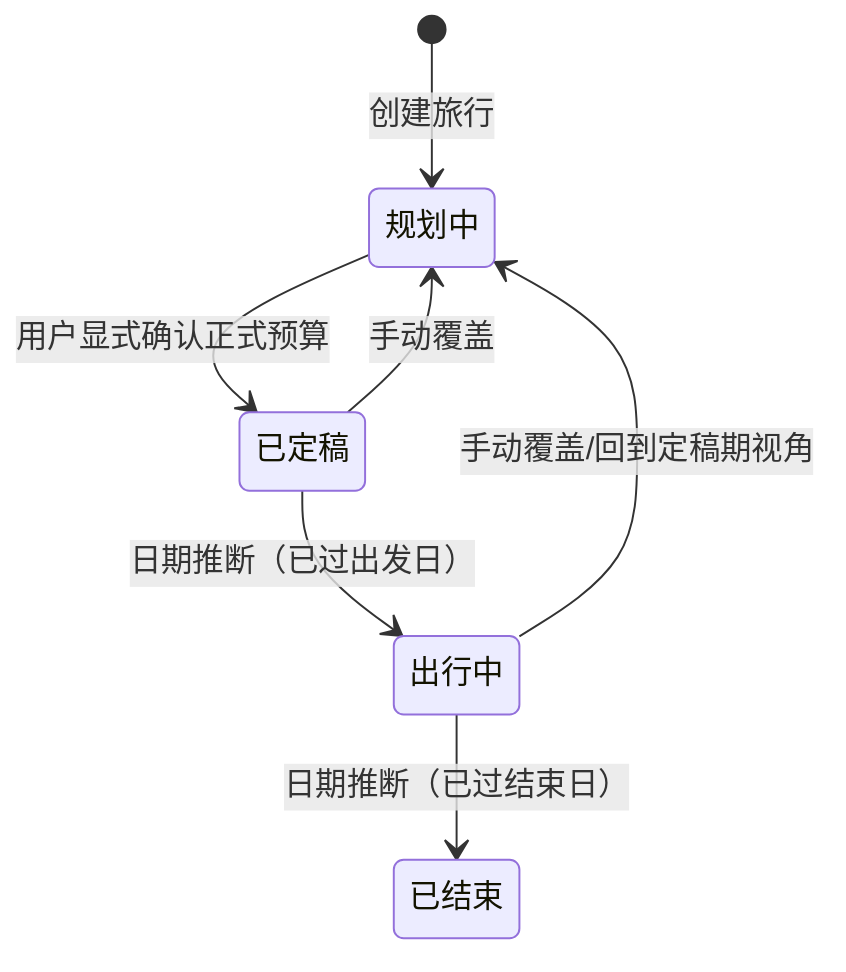
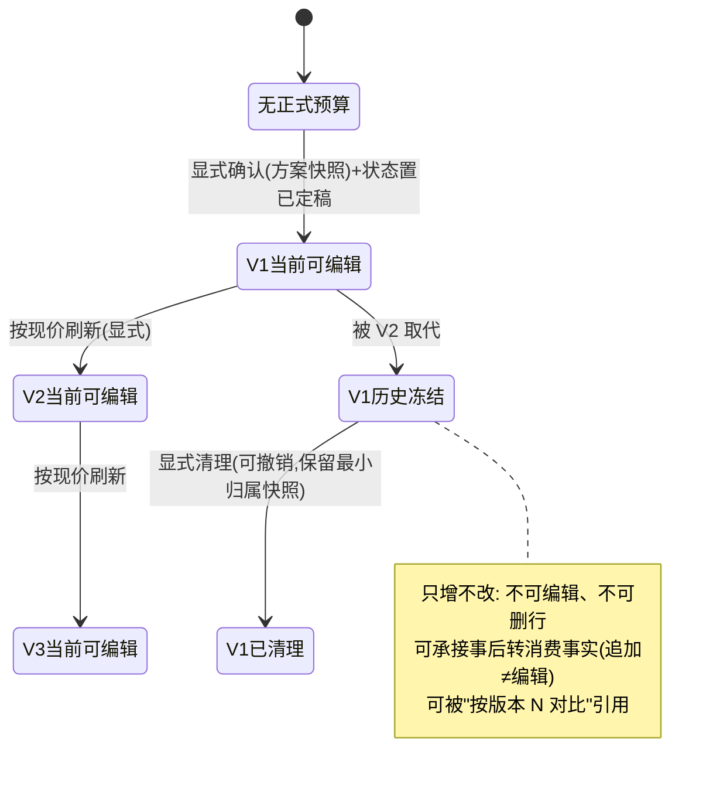
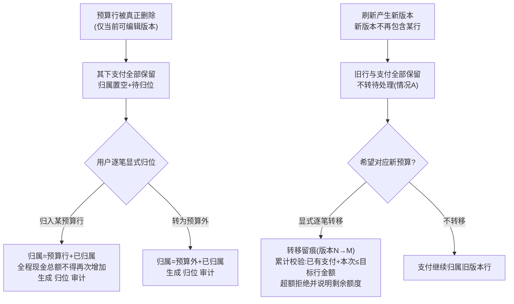
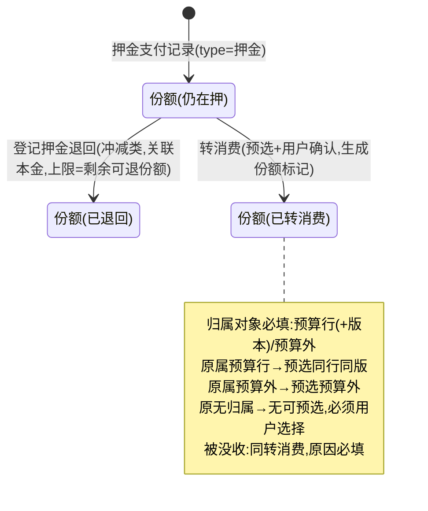
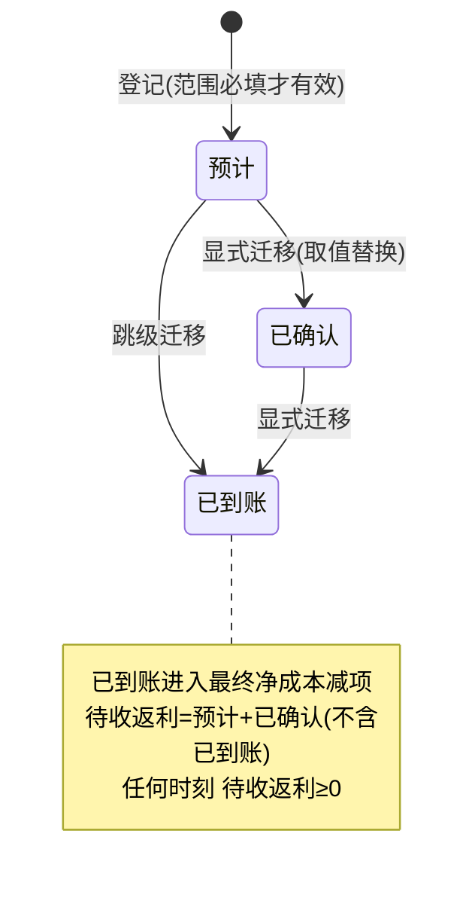
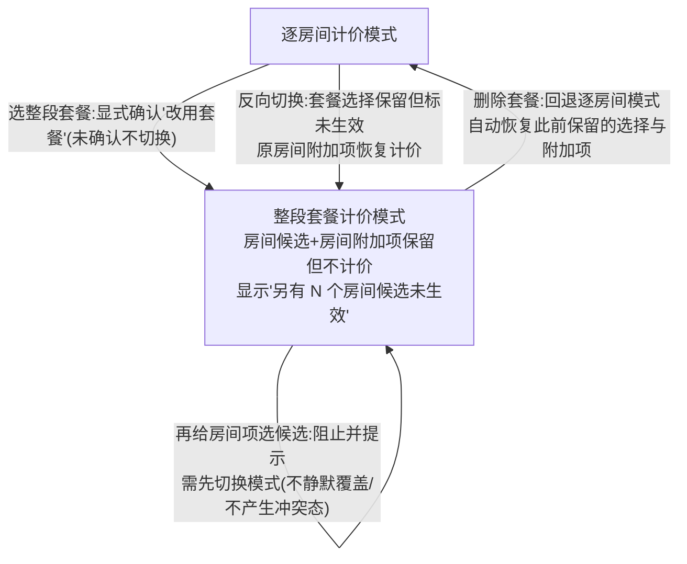
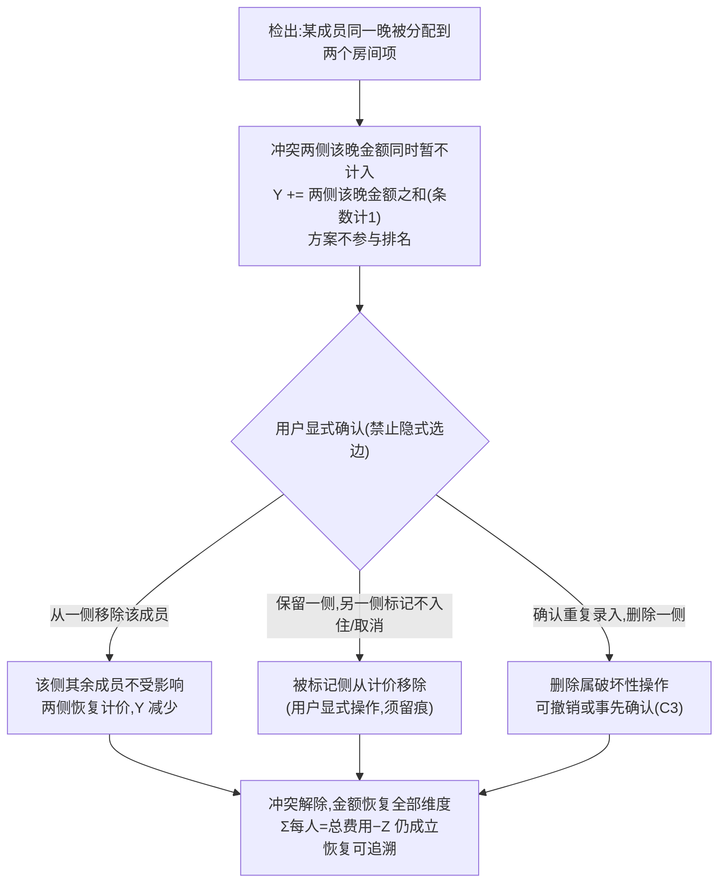
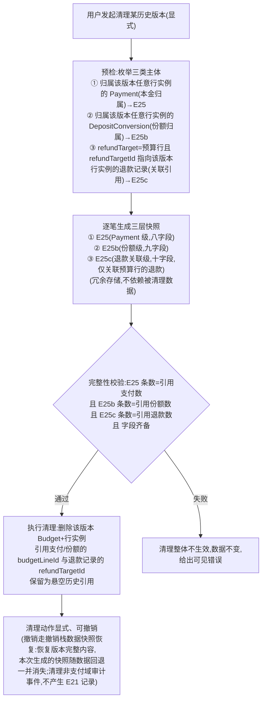

# TripScope 领域模型设计 v1.2.1（基于 V8.1 定向修订）

> **文档性质：设计文档（待人工审查）**。v1.2.1 是 v1.2（基线 `2690b11`）的审查修复定向版，补齐：退款关联预算行的历史引用快照（E25c，修复外部审查 P1）、来源快照的计价状态结构（stayModes/quantityDecision，P2）与自审报告状态/措辞（P3）。v1.2 的变更（双层快照、来源追溯、类型纠错）全部保留；配套自审报告见 `docs/domain-model-v1.2.1-review.md`（v1.2 轮报告为 `docs/domain-model-v1.2-review.md`，历史保留）。审查通过前不构成实现依据。
> **不修改冻结需求**：`docs/requirements-v8.md`（冻结基线 `dc46fe0`）与 `docs/review-v7-to-v8.md` 是唯一需求依据，本文只做"需求 → 领域模型"的转化，不改写、不复写任何冻结规则。
> **审查基线**：需求侧 `4bf34ad`（`dc46fe0` 之子，纯文档冻结标注提交；业务规则以 `dc46fe0` 为准）；模型侧 v1 基线 `b0af15f`、v1.1 基线 `6d1a284`、v1.2 基线 `2690b11`。
> **本文与公式的纪律**：现金指标公式唯一规范定义处为冻结文档 D-80b；本文登记指标名、统计范围、过滤器与约束，**不复制任何完整公式**（BC-34/BC-36 的模型侧执行）。本文所有引用若与冻结文档有出入，**以冻结文档为准**。

---

## 0. 版本变更记录

### 0.1 v1.2.1 变更记录（2026-11-09 审查修复定向修订）

> 修订范围：修复 v1.2 外部审查的 1 项 P1 与 1 项 P2、2 项 P3。不推翻 v1.2 任何设计（双层快照/来源块/纠错机制全部保留），不裁决任何未决问题（Q1/Q2/Q7/Q9/Q16/Q17 状态不变），不修改冻结需求。

| 编号 | 修订内容 | 涉及章节 |
|---|---|---|
| v1.2.1-P1 | **退款关联预算行的历史引用纳入清理快照**：新增第三层快照 **E25c RefundAnchorSnapshot（退款关联级）**——`refundTarget=预算行` 且目标行在被清理版本时强制前置生成；清理预检从两类主体扩为**三类主体**（Payment 本金归属 / DepositConversion 份额归属 / 退款记录的 refundTargetId 引用）；显式澄清**冲减类记录不携带归属对象与归属状态**（作用对象仅由 refundTarget 表达，D-80b/D-81 公式取数路径的结构化）；关联单笔的目标支付不被清理、永不悬空，无需快照（论证见 §4.13/§7.7） | §2、§3、§4.11、§4.13、§5、§7.7、§8.2（DM-08 再重写）、§10、§13、§14、§16 |
| v1.2.1-P2 | **来源快照补计价状态**：sourceSnapshot 结构由"纯候选 ID 列表"扩展为选择状态快照——selections 增补 `quantityDecision`、新增 `stayModes`（住宿计价模式是组合层持久状态，不可从候选选择推导，DM-01）；并论证策略甲下来源方案持久持有同等状态、方案删除后的追溯降级与"始终生成"备选一并纳入待确认 | §4.10、§15 |
| v1.2.1-P3 | v1.2 自审报告状态修正（已提交 `2690b11`）与"11 场景"措辞修正（设计推演 ≠ 自动化测试）；报告尾部补 v1.2.1 审查附注 | docs/domain-model-v1.2-review.md |

### 0.2 v1.2 变更记录（2026-11-09 定向修订）

> 修订范围：历史归属快照双层化（P1-01）、预算版本来源追溯（P2-01）、支付类型纠错机制（P2-02）、文档状态统一（P2-03）与文档细节修复（P3）。不推翻实体总体划分，不裁决任何未决问题（Q1/Q2/Q7/Q9/Q16/Q17 状态不变），不修改冻结需求。（本节编号 "v1.2-Px-xx" 对应本轮任务书问题编号，与 v1.1 轮的 P1-01/P2-01~05 内部编号相互独立。）

| 编号 | 修订内容 | 涉及章节 |
|---|---|---|
| v1.2-P1-01 | **E25 历史归属快照双层化**：由"Payment 级单条快照"改为 **Payment 级（E25）+ 转消费份额级（E25b ConversionAnchorSnapshot）组合快照**；预检/生成/校验/清理流程覆盖两层；新增快照唯一键、多次清理追加不覆盖规则；快照仍仅追溯、不参与计算 | §2、§3、§4.11、§4.12、§4.13、§5、§7.1、§7.7、§8.2（DM-08 重写）、§10.1、§10.2、§13、§14 |
| v1.2-P2-01 | **预算版本来源追溯**：E15 新增版本级来源块 `sourceType` / `sourcePlanId` / `sourceSnapshot`；每版本记录**实际生成来源**，禁止默认"刷新来源=首次确认来源"或"刷新来源=当前组合"；来源快照的启用随刷新策略裁决（待确认） | §4.10、§8.2（DM-09 新增）、§14、§15、§16 |
| v1.2-P2-02 | **支付类型纠错机制**：新增专门"支付类型纠错"操作为唯一跨分类通道（保留原 Payment 记录与全部关联事实，不删除重录）；逐方向前置核查；追加式审计 + 补偿链；删除重录降级为最后手段【待确认设计】 | §4.13、§6.2、§7.4、§8.2（DM-10 新增）、§10.4、§14 |
| v1.2-P2-03 | **文档状态统一**：README 不再把领域模型描述为未来工作；v1.1 自审报告不再把已提交内容描述为未提交工作区状态；历史文档保留可追溯性 | README.md、docs/domain-model-v1.1-review.md |
| v1.2-P3 | **文档细节修复**：§8 标题 DM 计数（DM-01~07 → DM-01~10）、§15/§16 自审统计与待确认清单更新、实体清单/关系图与双层快照同步、交叉引用核对 | §0、§3、§5、§8、§15、§16 |

### 0.3 v1.1 变更记录（2026-11-09 定向修订）

> 修订范围：仅身份、审计与历史数据生命周期。不推翻实体总体划分，不裁决任何未决问题（Q1/Q2/Q7/Q9/Q16/Q17 状态不变），不修改冻结需求。

| 编号 | 修订内容 | 涉及章节 |
|---|---|---|
| P1-01 | 消除"预算行实例 ID 跨版本不变"与"刷新产生新行实例"的定义矛盾：拆分为 `budgetLineId`（实例 ID）与 `logicalLineId`（逻辑 ID）双身份，全文统一语义 | §4.0、§4.10、§4.11、§4.12、§4.13、§5、§6.1、§7.1、§7.3、§7.5、§8.2（DM-02/DM-07）、§10、§13、§14 |
| P2-01 | AttributionAudit 按"操作类型 + 专属载荷"重构：归属类（建立/变更/转移/归位）与金额/日期/类型调整分离，废除含混的通用 before/after；新增类型调整的跨分类禁令（防绕过押金转消费）【待确认】 | §4.13、§6.2、§6.4、§7.4 |
| P2-02 | 统一"追加式审计 + 撤销/重做"机制：撤销不删除原审计，追加反向补偿记录（originAuditId 链 A→B→C）；审计追加与业务状态变更同批提交 | §4.13、§8.2（DM-03）、§10.4 |
| P2-03 | 版本清理前的历史快照由"可选"改为"强制前置"：预检 → 逐笔生成 → 完整性校验 → 清理；失败不生效；三种版本终态显式区分 | §4.13（E25）、§7.7（新）、§10.1 |
| P2-04 | 预算刷新来源保持待确认：`sourcePlanId` 定位为"首次确认的原始来源信息"；刷新取数策略（原方案 vs 当前组合）不裁决，补两种策略影响分析 | §4.10、§15 |
| P2-05 | CostSettings 挂载位置完成边界论证：对象级共享字段 / 候选级字段 / 快照字段的边界表；维持共享设计为当前取向，仍标待确认 | §4.8、§7.8（新）、§15 |

---

## 1. 设计目标与边界

### 1.1 目标

将 V8.1 冻结需求（正文 + review §5 领域模型准备）转化为清晰、完整、无歧义的领域模型：

1. 完整覆盖冻结需求中的全部业务概念，每个概念可追溯到需求条款；
2. 实体、属性、关系、生命周期、不变量全部明确；
3. 关键金额规则（金额守恒、押金份额、归属审计、三个已付粒度）在模型中可表达且经得起 AC-LED-19 系列验收用例推演；
4. 六个未决问题（Q1/Q2/Q7/Q9/Q16/Q17）全部以"可配置/待定扩展点"方式预留，不擅自裁决；
5. 与现有 `src/core/` 技术骨架的差异与衔接方式明确。

### 1.2 边界与禁做清单

本文**不做**以下事情：

- 不修改业务代码、UI、存储结构、迁移逻辑（`src/core/` 现状只读分析）；
- 不修改冻结需求与 review 文档；
- 不实现任何功能，不引入表结构/接口签名（本文到"概念 + 属性语义 + 约束"为止，字段类型仅给出语义约定）；
- 不把技术偏好写成业务规则——凡超出冻结文档的设计决定，一律标注「技术建议」或「待确认设计」；
- 不裁决 Q1/Q2/Q7/Q9/Q16/Q17；
- 不 Commit、不 Push。

### 1.3 记号与纪律（全文通用）

1. **现金指标一律具名引用**（BC-32）：消费实际支付、全程现金总额、当前版本已付、指定预算版本已付、预算行已付、参考差额、最终净成本。不使用 ①②③ 跨章节互指；引用 D-37 五层口径时写「D-37 的 ②」等带章节限定形式。
2. **公式唯一来源**（BC-34/BC-36）：全部现金公式见 `requirements-v8.md` D-80b「三套口径」表与「四个汇总值的完整展开式」表。本文第 9 节只做指标登记表。
3. **三类计数 Y/Z/R**（I-21/BC-25）：Y = 因 L1 未计入、且有金额可计的部分；Z = 已计入但参与人为空的部分；R = 已计入但归属日期在旅行范围外的部分。三者互不抵扣、互不混用。
4. **三类金额互不叠加**（I-02a/D-51a）：条目原始金额 / 日期分摊明细 / 人员分摊明细，各自只服务于总额 / 逐日 / 每人。
5. **事实与派生分离**（I-04）：派生值不持久化为独立真相；例外仅限承载"不可从当前状态重建的事实或用户显式决定"的记录（审计、确认留痕、转消费标记、最小历史归属快照），见 §10。

---

## 2. 业务概念词汇表（阶段 A）

> 类别取值：实体 / 子对象（实体内部结构，无独立生命周期）/ 关系记录 / 枚举 / 派生 / 审计 / 展示。

| 概念 | 类别 | 定义（含模型定位） | 来源条款 |
|---|---|---|---|
| 旅行 Trip | 实体（根） | 一次出行的根聚合；持有身份、名称、日期范围、状态 | §1.1、§2.2、D-100 |
| 旅行状态 | 枚举 | 规划中/已定稿/出行中/已结束；只影响默认视图与提醒，不锁数据；「已定稿」必须显式产生 | §2.2 |
| 使用阶段 | 展示 | 六个阶段（规划/定稿/决策后/出行中/归来/分享）是使用视角，非独立数据 | §2.1、§2.3 |
| 成员 Traveler | 实体 | 称呼 + 票档 + 可选年龄/备注；移除保护（提示参与面）与"历史成员"状态 | D-01、D-08 |
| 票档 FareTier | 实体 | 价格类别，用户命名与增删，内置默认四档；价格的挂载点；不做年龄自动判定 | D-02、D-05、D-06 |
| 候选报价库 | 关系（Trip↔候选） | 事实集合，供方案引用；大量录入、可复制、可筛选 | R1、D-60 |
| 交通候选 | 实体 | 挂在一个或多个区段上的报价（含整段联程套餐）；票档价格项、附加子项、来源、退改文本 | D-10~D-16 |
| 房间候选 | 实体 | 挂在单个房间项上的报价；**报价数量口径必填**（每间价/整单价） | D-21 第 1~5g 条 |
| 整段套餐候选（住宿） | 实体 | 挂在住宿单上的一口价，覆盖全部晚数与全部房间项 | D-21 第 6~12 条 |
| 自由费用项候选 | 关系（预留） | 是否允许自由费用项挂候选由 **Q17** 裁决；模型预留不启用 | Q17、§9 |
| 区段 Leg | 实体 | 出发地→目的地 + 出发日期（可选时刻）；交通管理单位；可命名/归组；一天多段 | D-10~D-13 |
| 跨日交通归属 | 规则 | 费用全额归属出发日期；到达日期仅信息项 | D-14 |
| 住宿单 Stay | 实体 | 酒店 + `[入住日, 退房日)` 半开区间；含多个房间项；区间连续、房间项共享区间 | D-20、D-46、BC-03 |
| 房间项 RoomItem | 实体 | 房型 + 间数 + 每间可住人数 + 入住成员 + 早餐安排 + 加床（声明）；房间项互不占用 | D-20、D-25 |
| 成员×晚分配 | 关系记录 | 房间项 × 成员的入住分配关系；冲突判定按「成员 × 晚」展开（派生）；"本晚不在"为 **Q16** 扩展点不启用 | D-23、Q10、Q16 |
| 房间项间数一致性 | 规则 | 候选数量口径与房间项间数不一致 → L2 + 未确认前不计价（"待确认数量"独立计数） | D-21 第 5a~5g 条、D-33 |
| 住宿计价模式 | 组合层状态 | 逐房间计价 / 整段套餐计价，互斥；模式是**组合层持久状态**，不可从选择集派生（DM-01）；切换保留未生效选择 | D-21 第 8a~8f 条、AC-CMP-16 |
| 价格项 PriceItem | 子对象 | 候选 × 票档的价格状态（未填/待估/已定价含 0/不适用）；比例价的活规则 | D-03、D-04 |
| 五态 | 枚举 | 未选择 / 未填 / 待估 / 已定价（含 0）/ 不适用，互斥、文本可辨 | C5、D-03、I-14 |
| 附加子项 Surcharge | 子对象 | 行李/选座/接送/早餐/加床/税费等独立金额构成；挂房间候选或整段套餐候选；标已含/另计 | D-16、D-22、D-22a |
| 优惠项 Adjustment | 子对象 | 商家优惠 / 平台优惠 / 非现金权益三类（**返利由 Rebate 实体单独承载**，见 §4.7）；金钱性参与计算、非现金只展示 | D-34、D-36 |
| 优惠超额 | 规则 | 保留原价与优惠、展示 0 元、标 L1、不进任何维度、不参与排名、修正自动解除 | D-35、D-90 |
| 返利 Rebate | 实体 | 互斥单值状态（预计/已确认/已到账）+ 形态（比例/固定）+ 适用范围（单项/多项/整单）+ 基数=实际应付 | D-38、D-38a、D-83、D-86 |
| 押金池 | 派生 | 已付但未退回、未转消费的押金合计；不属于消费实际支付 | D-37、D-39、D-80b |
| 押金三去向 | 规则 | 仍在押 / 已退回 / 已转消费，**金额份额互斥**，守恒成立 | D-39、D-80b、BC-31 |
| 押金转消费份额 | 子记录 | 押金支付记录上的显式标记：金额+日期+原因+归属对象（预选+用户确认） | D-39、D-80b 转消费规则 1~6 |
| 历史归属快照 | 子记录 | 版本清理前强制生成的**三层追溯记录**：Payment 级（E25）记录支付本金归属；转消费份额级（E25b）逐份额记录归属；退款关联级（E25c）记录退款对预算行的关联引用；仅展示追溯，不参与任何金额计算 | D-72a 第 4 条、D-40【E25c 为 v1.2.1 新增】 |
| 补偿收入 | 实体（最小记录） | 超额赔付/理赔：只记录与单列展示，不进任何口径与退款额度；不扩成收入管理 | D-40 二、E16a |
| 退款 | 规则 | 冲减类记录；按关联方式判上限（单笔/预算行）；押金不占额度；无法关联→未关联退款 | D-40、D-80b |
| 支付记录 Payment | 实体 | 统一集合；类型七种映射三分类（流出/冲减/押金）；归属对象三取值 + 归属状态两取值 | D-80、D-80b |
| 记录类型三分类 | 枚举映射 | 流出类（预付/尾款/全款/其他）/ 冲减类（退款/押金退回）/ 押金类（押金）；任何汇总先按类型筛选 | D-80b、I-20e |
| 归属对象 / 归属状态 | 枚举×2 | 对象：预算行/预算外/空；状态：已归属/待归位；待处理 = 空+待归位，不是第三种归属值 | D-80、D-87a、I-20 |
| 预算外支出 | 归属取值 | 归属=预算外的支付记录，不是支付之外的另一笔钱；D-82 的"临时支出/未预算支出"即此取值的录入称谓 | D-80 集合口径、D-82、I-20c |
| 待处理支付 | 状态 | 归属为空+待归位；计入全程现金总额，不计入任何版本已付/预算外 | D-87a、I-20c、BC-27 |
| 方案 Plan | 实体 | 具名选择集：引用候选（引用式，实时反映）；复制方案只复制选择关系 | D-70、D-71 |
| 当前组合 | 工作状态 | 未存档的选择集（与方案同构、无名称）；旅行的工作选择状态 | 术语表、D-71 |
| 正式预算 Budget（版本） | 实体 | 决策时刻快照；版本链；旧版只增不改；P1 保留当前版+上一版 | D-72、D-72a、Q3、Q14 |
| 预算行 BudgetLine | 实体 | 版本内冻结行：名称/应付/承担方式/分摊设置/日期归属；支付唯一归属锚点；删行只允许在当前可编辑版本 | D-72、D-72a、D-80、D-87 第 6 条 |
| 情况 A / 情况 B | 两种事件 | 刷新未包含（旧行与支付全保留、不转待处理）≠ 行被真正删除（支付转待处理） | D-87 第 6 条、I-20a、BC-21 |
| 支付转移 | 操作 | 逐笔显式、留痕、累计校验 `目标行已有支付 + 本次 ≤ 目标行金额` | D-87 第 4 条、BC-30 |
| 归位 | 操作 | 待处理支付显式重新归属（行/预算外），保留原始数据、逐笔留痕 | AC-LED-14a、AC-LED-19h |
| 归属审计 | 审计实体 | 归属建立/变更/转移/归位/支付调整的追加式留痕；首次建立同样留痕 | D-80b 规则 4、D-87 第 4 条、D-40 二.5、AC-LED-19o3/19q |
| 三个已付粒度 | 派生指标 | 预算行已付 / 指定预算版本已付 / 当前版本已付（仅最新版）；消费实际支付是独立指标 | D-80b、BC-38、I-06 |
| 全程现金总额 | 派生指标 | 旅行级现金口径；押金开关由 Q2 决定（未决，可开关且口径可见） | D-87a、Q2、BC-28 |
| 参考差额 | 派生指标 | 差额不是已付；可为负；恒不含押金、与 Q2 无关 | D-87a、BC-28 |
| 最终净成本 | 派生指标 | 被减数 = 消费实际支付；减项 = 已到账返利；公式见 D-80b | D-36、D-80b、I-07 |
| 待收返利 / 预期净成本 | 派生 | 待收 = 预计 + 已确认（不含已到账）；预期净成本 = 应付 − 待收返利 | D-38、D-84、I-19a |
| 复盘三差 | 派生 | 预算差 / 净成本差 / 待收返利，分开显示并标口径 | D-84 |
| X / Y / Z / R | 派生计数 | 已计入 X、因异常未计入 Y、未分摊到人 Z、范围外已计入 R；四数同屏、互不抵扣 | D-55、I-08、I-21 |
| 日期分摊明细 | 派生 | 原始金额按晚/天/段切分；守恒见 I-03；最大余数法、住宿按晚 | D-41~D-46、D-51a |
| 人员分摊明细 | 派生 | 按承担方式切给成员；参与人为空 → 空集（非全 0），金额进 Z | D-50、D-51a、BC-09 |
| 承担方式 / 参与人 | 枚举+关系 | 全员均摊/指定成员/部分成员均摊（按权重 P2 预留）；参与人默认全员、可为空、不得自动补 | D-50、D-07、D-08 |
| 归属日期与分摊方式 | 组合设置 | 单日 / 区间含首尾（普通）/ 住宿半开区间按晚；全额起始日 / 按天（晚/段）均摊 / 自定义权重 P2 | D-41~D-44 |
| L1/L2/L3 | 枚举（派生告警） | 阻断级（排除+不排名+不阻止保存）/ 警告级 / 提示留档级；任何一级可见、不静默 | D-90、D-91 |
| 悬空引用 | 规则 | 候选删除 → 引用处 L1，可一键重新指定 | D-71、D-90 |
| 报价来源信息 | 值对象 | 平台/查询日期/适用日期/有效期/链接（纯文本永不联网）/备注/退改/年龄规则文本 | D-60~D-63、D-06、D-24 |
| 报价数量口径 | 枚举 | 每间价/整单价，房间候选必填；缺失 → 计价要素不完整（L1） | D-21 第 5a 条、BC-22 |
| 待确认数量 | 状态 | 数量口径不一致且未确认；独立于"待估"计数；未确认前不产生金额 | D-21 第 5c/5g 条、D-33 |
| 旅行日期范围 | 视图窗口 | 不是数据边界；缩短不删数据、不平移、不重新归属；范围外走 R | D-45、D-109 |
| 文件身份与保存 | 骨架能力 | UUID 身份、草稿、冲突三选一、安全模式、迁移链（骨架已实现约 80%） | D-100~D-108 |
| 撤销 | 实现层 | 会话内 50 步、不覆盖 I/O、切上下文清栈；批量操作一个撤销单元 | D-105、D-106 |
| 导入/输出 | 展示层 | 打开/导入 JSON=整体替换；导出行程单/对比文字版；金额显示可切换 | D-107、R7、Q8 |

---

## 3. 实体清单总览（阶段 B）

> 编号沿用 review §5.1 的 E-xx（保持追溯连续），新增实体续编 E21~E25（v1.2 新增 E25b，v1.2.1 新增 E25c）。类型列区分：实体 / 子对象 / 关系记录 / 派生 / 审计 / 实现层。

| 编号 | 实体 | 建议代码名 | 类型 | 一句话职责 | 来源 |
|---|---|---|---|---|---|
| E01 | 旅行 | `Trip` | 实体（根聚合） | 身份、名称、日期范围、状态、全部域对象容器 | D-100、§2 |
| E02 | 成员 | `Traveler` | 实体 | 计价与分摊的人员输入；含历史成员状态 | D-01、D-08 |
| E03 | 票档 | `FareTier` | 实体 | 价格类别标签与价格挂载点 | D-02 |
| E04 | 交通候选 | `TrafficCandidate` | 实体 | 区段（可多区段）上的报价事实 | D-10~D-16 |
| E04a | 房间候选 | `RoomCandidate` | 实体 | 单个房间项上的报价事实；数量口径必填 | D-21 |
| E04b | 整段套餐候选 | `StayPackage` | 实体 | 住宿单级一口价候选；与房间候选互斥生效 | D-21 |
| E05 | 价格项 | `PriceItem` | 子对象 | 候选 × 票档的价格状态与金额/比例 | D-03、D-04 |
| E06 | 附加子项 | `Surcharge` | 子对象 | 独立金额构成；挂房间候选或整段套餐候选 | D-16、D-22、D-22a |
| E07 | 优惠项 | `Adjustment` | 子对象 | 商家/平台/非现金权益三类优惠 | D-34、D-36 |
| E08 | 交通区段 | `Leg` | 实体 | 交通管理单位与费用归属锚（出发日期） | D-10~D-15 |
| E09 | 住宿单 | `Stay` | 实体 | 半开区间住宿事实与房间项容器 | D-20、D-46 |
| E10 | 房间项 | `RoomItem` | 实体 | 房型/间数/容量/入住分配/需求声明 | D-20、D-23、D-25 |
| E11 | 自由费用项 | `Expense` | 实体 | 规划侧非交通非住宿费用（Q17 决定是否挂候选） | D-30、Q17 |
| E12 | 费用条目 | `CostEntry` | 抽象投影 | 计价单元的统一语义（组合层投影 / 预算行实例） | D-30、D-70 |
| E13 | 分摊明细 | `Allocation` | 派生 | 日期分摊与人员分摊两类派生明细 | D-51a |
| E13a | X/Y/Z/R 计数 | — | 派生 | 汇总四个数与异常计数（含无金额 L1 计数） | D-55、D-51a |
| E14 | 方案 | `Plan` | 实体 | 具名引用式选择集 | D-70、D-71 |
| E15 | 正式预算版本 | `Budget` | 实体 | 快照版本链；版本冻结与对比 | D-72、D-72a |
| E15a | 预算行 | `BudgetLine` | 实体 | 版本内冻结行；支付唯一锚点 | D-72、D-80、D-87 |
| E16 | 支付记录 | `Payment` | 实体 | 统一集合的钱进出记录；三分类+归属对象+归属状态 | D-80、D-80b |
| E16a | 补偿收入 | `Compensation` | 实体（最小记录） | 超额赔付留档；不进任何口径 | D-40 二 |
| E17 | 返利记录 | `Rebate` | 实体 | 三态互斥、范围必填、基数=实际应付 | D-38、D-83、D-86 |
| E18 | 冲突/告警 | `Issue` | 派生 | L1/L2/L3 告警的派生集合 | D-90、D-91 |
| E19 | 撤销记录 | `UndoEntry` | 实现层 | 会话内逆操作描述（骨架未实现，需新增） | D-105 |
| E20 | 文件元信息 | `FileMeta`（=TripNode 顶层） | 实现层（骨架已有） | 数据版本、时间、签名、身份 | D-100~D-108 |
| E21 | 归属审计 | `AttributionAudit` | 审计 | 归属建立/变更/转移/归位/支付调整的追加式留痕 | D-80b 规则 4、D-87 第 4 条、D-40 二.5 |
| E22 | 组合层选择记录 | `PlanSelection` | 关系记录 | 消费对象 → 候选的引用（可空）+ 数量口径确认决定 | D-71、D-21 第 5c 条 |
| E23 | 成员×晚分配 | `RoomAssignment` | 关系记录 | 房间项 × 成员入住关系；Q16 扩展点预留 | D-23、D-25、Q16 |
| E24 | 押金转消费份额 | `DepositConversion` | 子记录 | 押金记录上的转消费标记（金额/日期/原因/归属/确认） | D-39、D-80b |
| E25 | Payment 级历史归属快照 | `PaymentAnchorSnapshot` | 子记录（清理前强制生成） | 版本清理后支付本金归属的可追溯锚（仅展示不参与计算） | D-72a 第 4 条 |
| E25b | 转消费份额级历史归属快照 | `ConversionAnchorSnapshot` | 子记录（清理前强制生成） | 版本清理后每份转消费归属的独立追溯锚（仅展示不参与计算） | D-72a 第 4 条【E25b 为 v1.2 新增】 |
| E25c | 退款关联级历史归属快照 | `RefundAnchorSnapshot` | 子记录（清理前强制生成） | 版本清理后退款对预算行关联引用的独立追溯锚（仅展示不参与计算；关联单笔/未关联不生成） | D-72a 第 4 条、D-40、I-20d【E25c 为 v1.2.1 新增】 |
| — | 费用设置块 | `CostSettings` | 值对象 | 承担方式+参与人+归属日期+分摊方式 | D-41~D-44、D-50 |
| — | 当前组合 | `CurrentComposition`（Trip 内） | 工作状态 | 与方案同构的未存档选择集 | 术语表、D-71 |

**明确不建的实体**（对齐 review §5.1 并复核）：币种（Won't #1，单一币种假设，只建"元"显示形态）、账户/余额、发票、供应商、评分、地图坐标、逐小时行程事件、成员关系（父子）、建议/推荐类实体（Won't #3）、收入/科目/对冲类实体（E16a 只是补偿备注）、独立"预算外支出"金额池（I-20c：预算外是归属取值）、独立"待处理支付"实体（I-20：空+待归位是状态）、把 RoomCandidate 与 StayPackage 合并的单候选实体（BC-16/I-18 风险）。

---

## 4. 实体属性定义

> 属性类型只给语义约定：`整数分`（int，≥0，见 C4/I-11）、`日期`（YYYY-MM-DD）、`文本`、`枚举`、`引用`（旅行内唯一 id，UUID，见 §4.0）。所有 id 作用域 = 旅行文件内唯一（D-100 身份模型：文件是唯一存储边界）。

### 4.0 id 与引用总则（DM-02 的基础）

1. 所有实体 id 在**旅行文件内唯一**，创建后不变（撤销/重做不改变已存 id）。
2. **预算行双身份（v1.1，P1-01）**：
   - `budgetLineId`（行实例 ID）：每个预算版本中的行实例独立持有；V1 与 V2 的对应行实例 ID **不同**；创建后不因刷新而改变。Payment 归属、转消费归属、审计记录引用的都是**实例 ID**。
   - `logicalLineId`（逻辑行 ID）：识别跨版本属于同一业务预算项的行；同一逻辑项在不同版本中实例 ID 不同、逻辑 ID 相同。只由"首次确认铸造 + 刷新传播"建立；**对应关系无法确定时不得静默建立**；不参与任何金额计算与归属。
   - 这是 BC-38"预算行已付跨版本唯一标识该行"的两个概念落地：**已付永远按实例 ID 统计**（锚定具体版本的具体行），**逻辑 ID 只服务版本对比与追溯**；同时满足"旧版本只增不改"（D-72a 第 1 条）。
3. 审计与快照记录内**冗余存储行实例 ID、行名与版本序号（及逻辑行 ID）**（不只是引用），使审计在行被清理后仍可读（AC-LED-19q"不得只记行名而漏版本"、AC-LED-14b）。

### 4.1 E01 Trip

| 属性 | 类型 | 语义 | 来源 |
|---|---|---|---|
| tripId | 文本（UUID） | 旅行身份，创建起不变；文件转发/复制/改名不改变 | D-100、D-101 |
| name | 文本 | 旅行名称 | D-100 |
| startDate / endDate | 日期 | 规划视图窗口（含首尾）；非数据边界 | D-45、D-109 |
| status | 枚举：规划中/已定稿/出行中/已结束 | 只决定默认视图与提醒；不锁数据；「已定稿」仅由显式确认产生 | §2.2 |
| statusManuallyOverridden | 布尔 | 状态是否被手动覆盖（未覆盖时按日期推断） | §2.2 第 2 条 |
| travelers / fareTiers | 引用列表 | 名册与票档 | D-01、D-02 |
| legs / stays / expenses | 引用列表 | 消费对象 | D-10、D-20、D-30 |
| candidates.traffic / candidates.rooms / candidates.packages | 引用列表 | 三类候选事实集合（分列持有，见 §4.6 说明） | D-21 |
| currentComposition | 工作选择集 | 当前组合（与方案同构、无名称） | 术语表、D-71 |
| plans / budgets / payments / compensations / rebates / attributionAudits | 引用列表 | 各域对象 | 各节 |
| displayConfig | 值对象 | 展示参数：全程现金押金开关（Q2 预留）、方案对比返利口径、金额显示/隐藏（Q8 已裁决） | D-87a、D-38a、R7 |

### 4.2 E02 Traveler / E03 FareTier

| 实体 | 属性 | 类型 | 语义 | 来源 |
|---|---|---|---|---|
| Traveler | travelerId | UUID | 旅行内唯一 | D-01 |
| | name | 文本 | 称呼（可只写"爸爸""老二"） | D-01 |
| | tierId | 引用 | 所属票档；票档是计价维度，身份不是 | D-02 |
| | age / birthDate | 可选 | 仅提示与留档，不参与判定 | D-06 |
| | note | 可选文本 | 备注 | D-01 |
| | active | 布尔 | false = 历史成员：仍参与既有费用，不作为新条目默认参与人；移除前须提示参与面并可撤销 | D-08 |
| FareTier | tierId | UUID | 旅行内唯一 | D-02 |
| | name | 文本 | 用户命名；内置默认四档（成人/儿童/婴儿/老人） | D-02 |

### 4.3 E08 Leg

| 属性 | 类型 | 语义 | 来源 |
|---|---|---|---|
| legId | UUID | 旅行内唯一 | D-10 |
| name / groupLabel | 可选文本 | 区段命名/归组（去程/返程/中段，自由文本） | D-10 |
| origin / destination | 文本 | 出发地/目的地（Q13 裁决：先自由文本，不建地点清单） | D-10、Q13 |
| departureDate | 日期 | 出发日期；跨日交通费用全额归属此日 | D-10、D-14 |
| departureTime | 可选文本 | 出发时刻；排序键（空则按录入序） | D-13 |
| arrivalDate / arrivalTime | 可选 | 到达信息项（仅展示，不计费） | D-14 |
| costSettings | CostSettings | 费用设置块（承担方式/参与人/归属/分摊方式） | D-41~D-44、D-50 |

### 4.4 E09 Stay / E10 RoomItem / E23 RoomAssignment

**Stay**

| 属性 | 类型 | 语义 | 来源 |
|---|---|---|---|
| stayId | UUID | 旅行内唯一 | D-20 |
| hotelName | 文本 | 酒店/住宿名称 | D-20 |
| checkInDate / checkOutDate | 日期 | 半开区间 `[入住, 退房)`；晚数 = 退房日 − 入住日；退房日住宿费恒 0；0 晚 → L2、倒置 → 拒绝（L1） | D-46、BC-17 |
| costSettings（套餐模式条目） | CostSettings | 整段套餐计价时该住宿单条目的费用设置 | D-50 |

**RoomItem**

| 属性 | 类型 | 语义 | 来源 |
|---|---|---|---|
| roomItemId | UUID | 旅行内唯一 | D-20 |
| stayId | 引用 | 所属住宿单；区间与住宿单共享 | D-20、BC-03 |
| roomType | 文本 | 房型 | D-20 |
| roomCount | 整数≥1 | 间数；数量口径校验的基准 | D-20、D-21 第 5 组 |
| capacityPerRoom | 整数≥1 | 每间可住人数；容量检查输入 | D-23 |
| breakfastPlan / extraBedPlan | 可选值对象 | 早餐安排/加床**需求声明**（含/不含/另付）；实际计价子项在候选 Surcharge 上（D-22a） | D-20、D-22、D-22a |
| assignments | E23 列表 | 成员×晚分配（关系记录） | D-23 |
| costSettings（逐房间模式条目） | CostSettings | 逐房间计价时该房间项条目的费用设置 | D-50 |

**RoomAssignment（E23）**

| 属性 | 类型 | 语义 | 来源 |
|---|---|---|---|
| assignmentId | UUID | 旅行内唯一 | D-23 |
| roomItemId / travelerId | 引用 | 分配关系两端 | D-23 |
| note | 可选文本 | 留档 | — |

- 分配关系默认覆盖住宿单全部晚数；冲突判定按「成员 × 晚」在派生层展开（半开区间内逐晚）。
- **Q16 扩展点**：本记录预留可选的"本晚不在"标记位（`nightExclusions`），**裁决前不启用、不实现**（D-23 已知局限段；未决期按 L2 警告 + 文案保留说明执行）。

### 4.5 E11 Expense

| 属性 | 类型 | 语义 | 来源 |
|---|---|---|---|
| expenseId | UUID | 旅行内唯一 | D-30 |
| category | 枚举：餐饮/门票/当地交通/购物/其他 | 自由费用项分类 | D-30 |
| name | 文本 | 名称 | D-30 |
| unit / quantity / period | 计价三要素 | 缺一不可，否则 L1 计价要素不完整 | C8、D-31 |
| amountCents | 整数分（Q17=A 时） | 一项一个价（当前默认形态）；明确 0 元合法（D-32），与待估区分 | D-30、D-32、Q17 |
| expenseCandidates | 引用列表（**Q17 预留，不启用**） | Q17=B 时自由费用项可挂多个候选比较 | Q17 |
| costSettings | CostSettings | 费用设置块 | D-41、D-50 |

### 4.6 候选三实体：E04 / E04a / E04b

**分列持有的理由**（对应 review §5.1 "必须分开"）：房间候选与整段套餐候选的适用对象、计价形态、生效语义完全不同；若合并为一个实体靠标志位区分，极易在"套餐生效时房间候选是否计价"上出错（BC-16、I-18 双倍计费风险）。交通候选与住宿两类候选的校验规则也不同（D-63：住宿 L1 / 交通 L2）。**存储布局**（同一列表还是分列）属实现选择；概念模型按三类分列登记。

**E04 TrafficCandidate（交通候选）**

| 属性 | 类型 | 语义 | 来源 |
|---|---|---|---|
| candidateId | UUID | 旅行内唯一 | R1 |
| legIds | 引用列表（1..n） | 覆盖的区段；单段候选长度 1，联程套餐候选覆盖多区段且选中即占用全部 | D-11、D-15 |
| priceItems | E05 列表 | 票档价格项；同一候选票档不得重复 | D-02、D-03 |
| surcharges | E06 列表 | 行李额与超重费、选座费、接送/接驳等独立子项 | D-16 |
| adjustments | E07 列表 | 优惠项 | D-34 |
| transportMode | 文本 | 飞机/火车/大巴/自驾/轮渡/其他（可自定义） | D-16 |
| carrier / flightNo | 可选文本 | 承运方与班次号 | D-16 |
| refundPolicyText | 可选文本 | 退改规则文本（截止日驱动提醒为 P2-08） | D-16、D-24 |
| ageRuleText / ageThreshold | 可选 | 年龄规则文本与可选阈值；仅提示留档，不参与计算 | D-06 |
| applicableDate | 日期 | 适用旅行日期；与占用日期不一致 → 交通 L2（可显式确认降 L3 留痕） | D-63 |
| sourceInfo | 值对象 | 平台/查询日期/有效期/链接（纯文本永不联网）/备注 | D-60~D-62 |
| cancelPolicyText | 可选文本 | 免费取消截止 + 取消费规则（文本） | D-24 |

**E04a RoomCandidate（房间候选）**

| 属性 | 类型 | 语义 | 来源 |
|---|---|---|---|
| candidateId | UUID | 旅行内唯一 | D-21 |
| roomItemId | 引用 | 所属房间项；每个房间项有自己的候选集合 | D-21 第 1 条 |
| quantityBasis | 枚举：每间价/整单价，**必填** | 报价数量口径；缺失 → 计价要素不完整（L1，AC-ENT-21） | D-21 第 5a 条、BC-22 |
| priceExpression | 值对象 | 金额表达：按间夜单价 / 按晚金额（保留每晚真实金额、不拉平）/ 整段一口价 | D-21 表、D-46 第 6 条 |
| pricingUnit | 枚举：间夜/晚/整段 | 计价周期 | D-31 |
| coverageStart / coverageEnd | 日期 | 适用区间；必须覆盖住宿单全部晚数，否则 L1 覆盖不足 | D-21 第 4 条、D-63、AC-ENT-13 |
| surcharges | E06 列表 | 挂房间候选的附加项；套餐生效时随候选一起被压制 | D-22a |
| adjustments | E07 列表 | 优惠项 | D-34 |
| caliberChangeTrail | 可选留痕 | 数量口径改判（如"该报价就是整单 2 间的价"）的 L3 留痕 | D-21 第 5c 条、D-90 L3 |
| sourceInfo | 值对象 | 同交通候选来源信息 | D-60 |

**E04b StayPackage（整段套餐候选）**

| 属性 | 类型 | 语义 | 来源 |
|---|---|---|---|
| candidateId | UUID | 旅行内唯一 | D-21 |
| stayId | 引用 | 所属住宿单；**只覆盖这一个住宿单**（跨店打包须拆单或走自由费用项） | D-21 第 6、12 条 |
| priceCents | 整数分 | 一口价；不可拆分、不可少住/拆晚（BC-05） | D-21 表 |
| surcharges | E06 列表 | 挂套餐的附加项（如整段停车/度假村费） | D-22a |
| adjustments | E07 列表 | 优惠项 | D-34 |
| sourceInfo | 值对象 | 来源信息 | D-60 |

> 套餐生效规则（生命周期 §6.7 详述）：套餐选中 → 该住宿单内所有房间项的独立候选与房间附加项**保留但不计价**；删除套餐 → 回退逐房间模式并**自动恢复**此前保留选择；任何切换不得静默删除选择（BC-23）。

### 4.7 E05 PriceItem / E06 Surcharge / E07 Adjustment

**E05 PriceItem**

| 属性 | 类型 | 语义 | 来源 |
|---|---|---|---|
| tierId | 引用 | 所属票档；同一候选上票档不得重复 | D-02 |
| state | 枚举：未填/待估/已定价/不适用 | 价格层四态；与组合层"未选择"合成五态（I-14） | D-03、C5 |
| form | 枚举：绝对 / 比例 | 给价方式；"免费（明确 0 元）"= 绝对 0 元（D-32 已定价 0 合法且必要） | D-04、D-32 |
| amountCents | 整数分（绝对时） | 已定价金额；0 元合法 | D-03 |
| baseTierId + ratio | （比例时） | 活规则：基数票档单价变化时重算；单档单价四舍五入到分；不得循环引用；整单一口价候选禁止比例 | D-04、BC-06 |
| note | 可选文本 | "含双早""免票"等说明 | D-32 |

> 票档价格项只建在票档适用的候选上（交通候选、门票类自由费用项候选）；房间候选按间计价、通常无票档价格项。D-03 的四态判定只作用于**存在的价格项**。

**E06 Surcharge**

| 属性 | 类型 | 语义 | 来源 |
|---|---|---|---|
| surchargeId | UUID | 旅行内唯一 | D-22 |
| hostKind / hostId | 引用 | 挂房间候选或整段套餐候选（D-22a）；交通候选的行李/选座/接送也挂候选 | D-16、D-22a |
| name | 文本 | 子项名称 | D-22 |
| amountCents 或 included | 整数分 / 布尔 | 另计金额，或"已含"标记（已含计入展示、不重复计价） | D-22 |
| unit / quantity / period | 可选计价三要素 | 早餐按人按天/按间按天、加床按晚等的要素留档 | D-22、C8 |

**E07 Adjustment**

| 属性 | 类型 | 语义 | 来源 |
|---|---|---|---|
| adjustmentId | UUID | 旅行内唯一 | D-34 |
| hostId | 引用 | 挂候选（或自由费用项，Q17 未决前自由费用项自身持有优惠项） | D-34 |
| category | 枚举：商家优惠/平台优惠/非现金权益 | **返利不在此实体**：D-34 的"返利"类别由 Rebate 实体单独承载（D-38/D-83 登记语义），避免同一笔返利在 Adjustment 与 Rebate 双重表示导致重复扣减；应付计算只减商家+平台（D-36 的 ②） | D-34、D-36、D-38 |
| amountCents | 整数分 | 优惠金额（非现金权益为内容描述，永不折算现金） | D-34 |
| note | 可选文本 | 说明 | D-34 |

### 4.8 E22 PlanSelection 与费用条目（E12）的投影语义

**E22 PlanSelection（组合层选择记录）**——组合层选择集（当前组合与每个方案各一份）

| 属性 | 类型 | 语义 | 来源 |
|---|---|---|---|
| selectionId | UUID | 旅行内唯一 | D-71 |
| subjectType | 枚举：leg/roomItem/stay/expense | 消费对象类型 | D-71 |
| subjectId | 引用 | 消费对象 id | D-71 |
| candidateId | 可空引用 | 已选候选；空 = 未选择（合法状态，I-14） | D-71、D-74 |
| quantityDecision | 可选值对象 | 数量口径确认决定：`确认按间数乘算`（L3 留痕 + decidedAt）；"改判整单价"是候选级修改（写入候选 caliberChangeTrail） | D-21 第 5c 条 |

**费用设置块 CostSettings**（挂在消费对象上，方案间共享——位置选择的理由与待确认标注见 §15 P2-2）

| 属性 | 类型 | 语义 | 来源 |
|---|---|---|---|
| sharingMode | 枚举：全员均摊/指定成员承担/部分成员均摊/按权重分摊(P2 预留) | 承担方式四选一（前三 P1） | D-50 |
| participantIds | 引用列表（可为空） | 参与人；默认全员（仅创建时填充，清空后不回填）；为空 = L2 + 金额进 Z + 人员分摊空集 | D-50、D-55、BC-09 |
| attributionDate | 日期（单日类） | 归属日期（交通=出发日、自由费用=所选日） | D-44 |
| allocationMethod | 枚举：全额计入起始日/按天均摊（住宿按晚、交通套餐按段、普通按自然日）/自定义权重(P2 预留) | 分摊方式 | D-42、D-44 |

**费用条目（E12）的统一语义**：费用条目不是第四张持久表，它有两个持久化形态与一个运行时投影：

| 层 | 形态 | 说明 |
|---|---|---|
| 组合层（当前组合/方案） | 消费对象 + PlanSelection + 对象上的 CostSettings → **运行时投影**（派生，不持久化为真相，I-04） | 排名资格、五态、Y/Z/R、分摊明细全部在此层派生 |
| 预算层 | BudgetLine（快照实例，持久化） | 确认时按 D-72 冻结名称/应付/承担方式/分摊设置/日期归属 |
| 记账层 | Payment 的归属锚点 = BudgetLine | 支付不挂候选、不挂方案（BC-10） |

**条目粒度表**（同一住宿单在两种模式下的条目切分）：

| 条目来源 | 条目粒度 | 费用设置块挂载 |
|---|---|---|
| 交通候选 | 每区段（联程套餐候选按其覆盖区段展开计价或整段归属，见 D-42） | Leg |
| 房间候选（逐房间模式） | 每房间项 | RoomItem |
| 整段套餐候选（套餐模式） | 每住宿单一条 | Stay |
| 自由费用项 | 每自由费用项 | Expense |

模式切换时，两种模式的条目上下文（选择+设置）各自随"被保留但未生效的选择"保留（D-21 第 8c/8e 条、BC-23）。

### 4.9 E14 Plan / 当前组合

| 属性 | 类型 | 语义 | 来源 |
|---|---|---|---|
| planId | UUID | 旅行内唯一 | D-71 |
| name / archivedAt | 文本 / 时间 | 具名与存档时间（对比时知道哪套是哪天算的） | review R5 隐含需求 |
| selections | E22 列表 | 选择关系；复制方案 = 复制本列表与模式状态，**不复制候选** | D-71 |
| stayModes | 映射 stayId → 逐房间/整段套餐 | **组合层持久状态**（DM-01：不可从选择集派生，8e 反向切换需表达"套餐已选但未生效"） | D-21 第 8a/8e 条、AC-CMP-16 |
| archiveTotalCents | 可选整数分 | 存档时合计参照值：仅用于"候选已变化，差额 +X"提示的基准（现值始终重算，此值非真相）【技术建议】 | D-71 提示差额 |
| 结构化标签 | 派生 | 非金额标签（时刻/含早/婴儿床/可取消）从候选与条目属性派生并排展示与筛选；不做加权评分 | D-76、Won't #4 |

**当前组合** = Trip 内与 Plan 同构的工作选择集（无名称/存档时间）；"保存方案"= 复制当前组合的选择关系与模式状态到新 Plan。

### 4.10 E15 Budget / E15a BudgetLine

**E15 Budget（版本）**

| 属性 | 类型 | 语义 | 来源 |
|---|---|---|---|
| budgetId | UUID | 旅行内唯一 | D-72a 第 2 条 |
| versionNo | 整数，从 1 递增 | 版本序号；版本切换在任何相关界面必须可见 | D-72a 第 2 条 |
| createdAt | 时间 | 生成时间 | D-72a 第 2 条 |
| sourceType | 枚举：首次确认 / 刷新 | **本版本的实际生成来源类型**（v1.2 P2-01）：首次确认与每次刷新各自记录自己的实际来源；**不默认"刷新来源=首次确认来源"，也不默认"刷新来源=当前组合"**（任务书 P2-01 明令禁止两种默认） | D-72、D-2.3【v1.2 新增；语义拆分自原 sourcePlanId】 |
| sourcePlanId | 可选引用 | **本版本实际取数来源方案**：首次确认时 = 被确认的方案（必填）；刷新时 = 该次刷新**实际使用**的来源方案（取数策略甲下有值；策略乙下为空，取数来源为当时当前组合）。**为空 ≠ 无来源**：表示来源为当前组合（由 sourceType 与 sourceSnapshot 共同说明） | D-72、D-2.3【v1.2 语义改写】 |
| sourceSnapshot | 可选值对象 | **刷新来源为当前组合时**（策略乙）的组合层**选择状态**最小快照（v1.2.1 P2 扩展结构，不是纯候选 ID 列表）：`{ snapshotAt: 时间, selections: [{subjectType, subjectId, candidateId, quantityDecision(如存在)}], stayModes: [{stayId, mode}] }`——selections 记"对象→已选候选→数量口径确认决定"；stayModes 记各住宿单的计价模式（**组合层持久状态，不可从候选选择推导，DM-01**，缺它则"该版本按逐房间还是套餐生成"不可解释）。**不记价格数值**（价格随候选变动、历史时点价格本不可重建，也不需要：版本行金额是快照真相）。策略甲下不生成（来源方案持久持有同等状态，selections+stayModes+quantityDecision 随方案可查）；方案被删除时来源追溯降级为"来源方案已删除"，如需删除后仍可解释来源状态，可裁决"甲策略也始终生成同构快照"（同一结构）——一并纳入待确认。**字段位预留，启用形态随刷新策略裁决** | 刷新来源可追溯性需要【v1.2 新增；v1.2.1 结构扩展；待确认设计：随刷新策略裁决启用】 |
| lines | E15a 列表 | 本版本的行（快照实例） | D-72 |
| 派生：isCurrentEditable | — | versionNo = 最大版本号；只有当前可编辑版本允许删行 | S-P1-03、D-87 第 6 条前置 |

**E15a BudgetLine（预算行实例）**

| 属性 | 类型 | 语义 | 来源 |
|---|---|---|---|
| budgetLineId | UUID | **行实例 ID**：本版本内行实例的身份；刷新产生新实例（对应行的 V1/V2 实例 ID 不同）；创建后不改写；Payment 归属与审计引用它（DM-02） | D-80b、BC-38、D-72a 第 1 条 |
| logicalLineId | UUID | **逻辑行 ID**：跨版本识别同一业务预算项（同一逻辑项跨版本实例 ID 不同、逻辑 ID 相同）；仅由"首次铸造 + 刷新传播"建立；**不参与任何金额计算、归属与审计定位**（那些只用实例 ID） | D-87 第 3 条【技术建议：冻结文档未命名该 ID，为满足版本对比而引入】 |
| budgetId | 引用 | 所属版本 | D-72 |
| name | 文本 | 行名称（快照） | D-72 |
| amountCents | 整数分 | 应付口径快照金额 | D-72 |
| sharingMode / participantIds | 快照 | 承担方式与参与人快照 | D-72 |
| attribution / allocationMethod | 快照 | 日期归属与分摊设置快照 | D-72 |
| sourceKind | 枚举：planObject / manual | 来源：方案条目 / 手动 | D-73 |
| sourceObjectId | 可选引用 | 来源消费对象 id（**刷新时逻辑行传播的确定性锚点**；与现价对比定位来源） | D-87 第 2、3 条、§4.10 传播规则 |
| sourceCandidateRef | 可选引用 | 来源候选回溯标识：仅用于"现价 vs 预算价"差额展示与刷新取数，**不因候选变化改金额** | D-72、review §5.2 关系 2 |
| manualReason | 可选文本 | 手动行原因 | D-73 |
| createdAt / updatedAt | 时间 | 手动行"每次调整记录时间" | D-73 |

**logicalLineId 的建立与传播规则（P1-01）**：

1. **首次确认（V1）**：为每行铸造逻辑 ID（每行实例各一个逻辑项起点）。
2. **刷新传播**：旧版本行若有来源对象（`sourceObjectId`）且该对象在刷新来源中仍有选择 → 新实例继承同一 `logicalLineId`；来源对象已无选择 → 不产生新实例（情况 A），逻辑 ID 只留在旧实例上。
3. **手动行**：铸造自己的逻辑 ID，**默认无跨版本对应**——版本对比中呈现为"新增/不再包含"；**不得按名称静默建立对应**（对应关系无法确定时不建立；v1 的"按名称对应"建议作废）。
4. **不参与计算**：`logicalLineId` 不进入任何现金指标、归属与审计定位（那些只用实例 ID）；仅服务于版本对比（D-87 第 3 条：同逻辑行=改额、仅新版有=新增、仅旧版有=不再包含）与追溯。

版本对比（D-87 第 3 条：总额差/类别差/行级新增删除改额）由 `logicalLineId` 对应关系派生。

**双 ID 标准示例（必须能完整回答以下五点）**：

| 属性 | V1 | V2 |
|---|---|---|
| budgetLineId | BL-001 | BL-101 |
| logicalLineId | LL-001 | LL-001 |
| 预算金额 | 500 | 600 |
| 所属版本 | V1 | V2 |

1. V1 的支付**仍然归属 BL-001**（实例 ID），刷新后不变——V1 行已付不变（D-87 第 1 条）。
2. V2 的新预算行是 **BL-101**，金额 600 是新快照值；BL-001 与 BL-101 是**两个不同的行实例**。
3. 两者通过 **LL-001** 识别业务对应关系（版本对比中显示为"同一项：500 → 600"）。
4. **刷新不得自动转移支付**：BL-001 上的支付不会因 LL-001 相同而跑到 BL-101；希望对应新预算必须显式转移并留痕（D-87 第 4 条、BC-30 累计校验）。
5. 历史版本与当前版本统计**各自准确**：V1 指定版本已付按 BL-001 求和、V2 按其全部行实例求和；互不借用（BC-38、DM-06）。

**刷新来源策略的影响分析（v1.1 轮 P2-04 引入；v1.2 P2-01 补版本级来源块后本分析仍成立；待确认，不构成裁决）**：

- **策略甲：按原始来源方案刷新**——只吸收该方案自确认以来的显式变更；当前组合的未存档改动不进入正式预算；来源可追溯性最强。
- **策略乙：按当前组合刷新**——吸收最新工作状态；可能把用户未存档的临时改动带入正式预算（与 C11"快照不可静默变更"的张力更大，须显式确认兜底）。
- 两种策略下**情况 A**（新版本不再包含某行）都可能发生；`logicalLineId` 传播、支付不自动转移（D-87 第 1 条）、快照规则（§7.7）在两种策略下完全一致。
- **本模型不预设任一最终策略**；实现前须人工裁决。

**版本来源的记录规则（v1.2 P2-01）**——无论最终裁决为哪种策略，来源块（sourceType / sourcePlanId / sourceSnapshot）的记录规则一致：

1. **首次确认**：`sourceType=首次确认`；`sourcePlanId`=被确认的方案；`sourceSnapshot` 不生成。
2. **刷新**：`sourceType=刷新`；`sourcePlanId` = 该次刷新实际取数来源（策略甲 = 原方案，策略乙 = 空）；**策略乙下每次刷新必须生成 `sourceSnapshot`**（记录刷新时点组合选择集），否则该版本的"实际生成来源"不可追溯。
3. **禁止默认**：不得实现成"刷新时 sourcePlanId 直接继承上一版的值"（= 默认每次刷新来自首次确认方案），也不得默认"刷新必来自当前组合"——每版本的来源块只记录**当次实际**来源。
4. **方案被修改或删除后**：版本内容是冻结快照（D-72、C11），不受来源变化影响；`sourcePlanId` 悬空时来源展示降级为"来源方案已删除"，历史预算的内容追溯以版本行快照字段为准（名称/金额/设置均已冗余快照在行上）。
5. **sourceSnapshot 的启用随策略裁决**：裁决为单一策略甲 → sourceSnapshot 永不生成；裁决为单一策略乙 → 每次刷新必生成；裁决允许"每次刷新时选择来源"的形态 → 按当次实际来源记录（来源为组合时生成快照）。三种裁决形态下本规则表均适用。

### 4.11 E16 Payment

| 属性 | 类型 | 语义 | 来源 |
|---|---|---|---|
| paymentId | UUID | 旅行内唯一 | D-80 |
| type | 枚举：预付款/尾款/全款/押金/押金退回/退款/其他 | 七种类型；到三分类的映射见 §9 | D-80、D-80b |
| amountCents | 整数分（正，绝对值） | 金额恒为正；冲减类"恒作减项"由分类决定，不由符号决定（禁止负数金额表达退款，FC-25） | D-80b、FC-25 |
| paymentDate | 日期 | 支付日期 | D-80 |
| method | 文本 | 支付方式（微信/信用卡/现金，文本记录；"付给谁"不做，Won't #2） | D-80、Q15 |
| note | 可选文本 | 备注 | D-80 |
| ownershipType | 枚举：预算行/预算外/空 | 归属对象；**预算外与空不持有行引用**（唯一实体关联是可选多对一 Payment→BudgetLine，I-20/FC-34）；**冲减类（退款/押金退回）不适用本字段——恒为空且不携带归属语义**（见下方"冲减类归属语义澄清"，v1.2.1） | D-80、I-20【冲减类豁免为 v1.2.1 澄清】 |
| budgetLineId | 条件引用 | 仅 ownershipType=预算行时非空；引用**预算行实例 ID**（不得引用逻辑行 ID）；所属版本被清理后保留为悬空历史引用 + E25 快照（§7.7）；**冲减类恒为空** | D-80、BC-35、D-72a 第 4 条 |
| attributionState | 枚举：已归属/待归位 | 归属状态；与归属对象的约束关系：空 ⇔ 待归位、非空 ⇒ 已归属（两个概念分开建模，BC-33）；**该约束仅适用于流出类与押金类**——冲减类不适用归属状态（不是待归属的钱，见下方澄清） | D-80、I-20【适用范围澄清为 v1.2.1】 |
| refundTarget | 枚举：具体支付/预算行/未关联 | 退款记录的关联方式；上限按关联方式判定（§6.2）；押金退回恒关联押金本金记录（本金是支付记录，不被版本清理、永不悬空）；**退款作用对象仅由本字段表达，不通过归属对象表达** | D-40、D-39 |
| refundTargetId | 条件引用 | 关联的支付 id 或预算行 id（未关联时为空并显式提示）；**目标为预算行且该行所属版本被清理时，保留为悬空历史引用 + E25c 快照（§7.7，v1.2.1）** | D-40、AC-LED-10、I-20d |

**冲减类归属语义澄清（v1.2.1）**：冲减类记录（退款/押金退回）在全部现金公式中**只作减项**，其作用对象**仅**由 `refundTarget`/`refundTargetId` 表达（关联单笔 / 关联预算行 / 未关联；押金退回恒关联押金本金）。因此：① `ownershipType`/`attributionState` 对冲减类**不适用**（冲减记录不是"待归属的钱"，也不通过归属对象进入任何行/版本统计——D-80b/D-81/D-87a 中退款全部经"关联该行的退款"路径取数，无归属路径）；② "待归位"状态对冲减类无意义，情况 B（删行转待处理）只作用于流出类与押金类支付；③ 由此"退款自身归属与退款目标归属不一致"在本模型中**结构性不可能**（自身无归属），该风险被结构消除而非依赖约定。此澄清是 D-80b/D-81 公式取数路径的显式化【解读性设计，与冻结公式一致，无新增业务规则】。
| conversions | E24 列表 | 押金转消费份额标记（仅 type=押金时使用） | D-39、D-80b |
| anchorSnapshots | E25 列表 | **Payment 级历史归属快照**（E25）——**未清理不生成；清理前强制生成**（预检→生成→校验，§7.7）；快照键 =（本支付，被清理版本），同一支付对同一版本至多一份；不同版本的快照追加共存、互不覆盖；仅展示追溯，不参与任何金额计算 | D-72a 第 4 条【v1.2 双层化】 |

**支付记录的不可变性**：金额、日期、类型一经写入，不受候选/方案/版本变化影响（D-87 第 5 条、BC-20）；用户显式调整须生成支付调整审计（D-40 二.5）。归属变化只通过 §6.4 的显式操作发生并留痕。

### 4.12 E24 DepositConversion（押金转消费份额）

| 属性 | 类型 | 语义 | 来源 |
|---|---|---|---|
| conversionId | UUID | 旅行内唯一 | D-80b |
| amountCents | 整数分（>0） | 该份转消费金额；同一押金可拆多份，各份互不重叠、守恒（DM-05）；每份只归属一个对象（D-80b 规则 5） | D-39、AC-LED-19p |
| conversionDate | 日期 | 转消费日期 | D-39 |
| reason | 文本（被没收时必填） | 转消费原因 | D-39、D-80b 第 5 条 |
| ownershipType | 枚举：预算行/预算外 | 转消费归属对象（**必填**，未确认不允许保存） | D-80b 规则 1、BC-35 |
| budgetLineId | 条件引用 | 仅归属=预算行时非空，引用**预算行实例 ID**；**预算外不持有版本与行引用**（预算外无版本概念，不得要求填写版本） | D-80b 规则 1~2、BC-35 |
| confirmedAt | 时间 | 用户确认时间（预选+确认两步，确认是生效条件） | D-80b 规则 1、BC-37 |
| confirmedBy | 文本 | 确认人/操作者（单用户离线应用记录应用上下文标识【技术建议】） | D-80b 规则 4、AC-LED-19o3 |
| anchorSnapshots | E25b 列表 | **转消费份额级历史归属快照**（E25b，v1.2 新增）——同一份额可因多次清理而累积多份快照（键 =（本份额，被清理版本）），追加不覆盖；仅展示追溯，不参与计算；生成时机与强制条件见 §7.7 | D-72a 第 4 条【v1.2 双层化】 |

> 转消费**不新增支付记录、不新增现金流出**（D-80b）：转消费是押金支付记录上的显式标记；原押金记录类型不改成流出类。已退回份额 = 关联该押金本金的"押金退回"类型支付记录之和（派生）。

### 4.13 E16a Compensation / E17 Rebate / E21 AttributionAudit / E25 + E25b + E25c 历史归属快照

**E16a Compensation（补偿收入，最小记录）**

| 属性 | 类型 | 语义 | 来源 |
|---|---|---|---|
| compensationId | UUID | 旅行内唯一 | E16a |
| amountCents | 整数分 | 赔付/理赔金额 | D-40 二.5 |
| compensationDate | 日期 | 到账日期 | D-40 二.5 |
| sourceNote | 文本 | 来源说明（商家赔付/保险理赔等） | D-40 二.5 |

约束：**不建立**到 Payment 或 BudgetLine 的关联；不进消费实际支付、不进最终净成本、不进预算侧、不占退款额度；刻意不扩成收入管理（无分类/科目/对冲/余额，E16a 说明、Won't #11）。

**E17 Rebate（返利记录）**

| 属性 | 类型 | 语义 | 来源 |
|---|---|---|---|
| rebateId | UUID | 旅行内唯一 | D-83 |
| state | 枚举：预计/已确认/已到账，互斥单值 | 状态迁移 = 取值替换（不是新增记录）；只允许单向逐级推进（可跳过已确认），不允许回退；需回退 = 撤销该返利登记后重录 | D-38、I-19a |
| amountForm | 枚举：比例/固定 | 二选一；改形态视为改规则，显式操作并留痕 | D-86 第 8 条 |
| ratio / fixedAmountCents | 比例值 / 整数分 | 按形态取一；比例型基数一律为实际应付（「D-37 的 ②」），三种范围同一口径；待估与 L1 条目不进基数、明确 0 元条目在基数但贡献 0 | D-86 计算基数、BC-19a、I-19b |
| scopeType | 枚举：单项/多项/整单 | 适用范围**必填**且唯一；未填 → 只展示不参与计算与排名（可存草稿） | D-83、D-86 第 5/10 条 |
| scopeTargetIds | 引用列表 | 单项 = 一个消费对象；多项 = 显式勾选的一组消费对象；整单 = 空（按各方案整体重算） | D-86 |
| receiveDate | 可选日期 | 到账后填写 | D-83 |
| note | 可选文本 | 备注 | D-83 |

> scopeTarget 指向**消费对象**（区段/房间项/住宿单/自由费用项），不是方案内条目实例——同一笔单项返利在各方案按该对象各自的应付重算（AC-CMP-17/18）。两笔不同返利覆盖同一条目合法；同一笔返利记录不得把同一条目算两次（D-86 第 9 条）。

**E21 AttributionAudit（归属与支付调整审计，v1.1 按 P2-01/P2-02 重构）**

公共字段（所有操作类型共用）：

| 属性 | 类型 | 语义 | 来源 |
|---|---|---|---|
| auditId | UUID | 旅行内唯一 | D-80b 规则 4 |
| operationType | 枚举：归属建立 / 归属变更 / 支付转移 / 待处理归位 / 金额调整 / 日期调整 / 支付类型调整 / **支付类型纠错（v1.2 新增，待确认）** | 每条记录只承载一个操作类型的专属载荷；不相关载荷字段缺省（不以 0/空串占位） | D-80b 规则 4、D-87 第 4 条、D-40 二.5、AC-LED-14a【纠错操作为技术建议，待确认】 |
| paymentId | 引用 | 涉及的支付记录（含押金本金记录）；**审计与原 Payment 的关联键** | D-80b |
| conversionId | 可选引用 | 涉及的转消费份额（归属类操作涉及时必填） | D-80b |
| amountCents | 整数分 | 本次变更涉及的金额（归属类=变更金额；金额调整类可由前后值承载） | D-80b 规则 4 |
| occurredAt | 时间 | 变更时间 | D-80b 规则 4 |
| confirmedBy | 文本 | 确认人或操作者（单用户离线应用记录应用上下文标识【技术建议】） | D-80b 规则 4 |
| actionGroupId | 可选 UUID | 同一用户动作产生多条审计记录时共享（一次动作同时改归属+金额时按字段族拆多条、同组关联）【技术建议】 | 追溯性需要 |
| originAuditId | 可选引用 | **撤销/重做补偿链**：本记录所针对的前序审计记录；空 = 原始动作记录（P2-02，见 §10.4） | D-105【技术设计】 |

按操作类型的专属载荷：

| operationType | 专属载荷字段 | 说明 |
|---|---|---|
| 归属建立 / 归属变更 / 支付转移 / 待处理归位 | `before` / `after`：归属取值对象 = 类型（预算行/预算外/空）+ **budgetLineId（实例 ID）+ 行名 + 版本序号 + logicalLineId（如存在）**（冗余存储）或"预算外"或"空" | 覆盖组合与禁例如下 |
| 金额调整 | `beforeAmountCents` / `afterAmountCents` | 记录原金额与新金额；调整后的金额仍受退款上限与守恒校验（BC-24、I-20d）（D-40 二.5、BC-24） |
| 日期调整 | `beforePaymentDate` / `afterPaymentDate` | D-40 二.5"调整属于显式操作，必须留痕"的延伸 |
| 支付类型调整 | `beforePaymentType` / `afterPaymentType` | 受跨分类禁令约束（见下） |
| **支付类型纠错（v1.2 新增，待确认）** | `beforePaymentType` / `afterPaymentType` + `correctionReason`（必填） + （冲减类互换时）`beforeOffsetTarget` / `afterOffsetTarget` | **唯一跨分类通道**（见下方"跨分类纠错机制"段）；撤销/重做走补偿链（§10.4）；删除重录不是默认纠错路径【技术建议，待确认】（D-40 二.5 延伸） |

**归属类覆盖组合（首版必须，与 v1 一致）**：空→预算行、空→预算外、预算行→预算行（含跨版本与同版本换行）、预算行→预算外、预算外→预算行；**预算外→预算外不构成变更、不产生审计**（D-82 预算外不细分消费对象）。首次建立归属同样留痕（AC-LED-19o3）。

**哪些操作必须产生审计（P2-01）**：① 归属建立/变更/转移/归位（D-80b 规则 4、D-87 第 4 条、AC-LED-14a）；② 支付金额、日期、类型的**显式调整**（D-40 二.5）；③ 撤销/重做产生的补偿事件（P2-02，技术设计）；④ 支付类型纠错（v1.2 P2-02【待确认】）。

**金额调整的历史可追溯性（P2-01）**：调整审计记录原金额与新金额；任何历史时点的已付/全程现金等指标可由"当前值 + 按审计链逆向回放"复原；调整不触碰其他支付记录，故其余指标的历史追溯不受影响；审计链（含补偿记录）永久保留。

**支付类型调整的跨分类禁令【技术建议，待人工确认】**：常规"支付类型调整"操作**仅允许发生在同一三分类内部**（流出类内部：全款↔尾款↔预付款↔其他；冲减类内部：退款↔押金退回；押金类无内部调整对象）。**押金类 ↔ 流出类、退款 ↔ 押金退回 之间禁止互转**——前者会绕过 D-39/D-80b 的"押金转消费必须显式操作+归属确认"流程（把资金占用伪装成消费），后者会让冲减对象错位（押金退回只冲本金、退款只冲消费）。冻结需求未定义类型调整规则；此禁令是为保护冻结规则而设的设计性收窄，需人工确认。

**跨分类纠错机制（v1.2 P2-02，唯一跨分类通道【技术建议，待确认设计】）**：跨分类类型录入错误**不走删除重录**（删除旧记录会切断按 paymentId 关联的全部事实——退款关联、转消费份额、审计链、历史归属快照），而走专门"支付类型纠错"操作：

1. **保留原 Payment 记录**：paymentId 不变，仅修改类型字段；金额、日期、归属一律不变（金额纠错走金额调整、归属纠错走归属类审计，互不混杂）。全部关联事实（refundTargetId 指向它的退款、其上的转消费份额、既有审计、既有快照）**因 id 不变而全部保留**。
2. **逐方向前置核查**（核查该记录的依赖事实，不满足则拒绝纠错并说明，数据不变）：
   - **押金 → 流出类**：该押金必须**无转消费份额**（存在则拒绝；转消费份额的修改语义属待确认项，裁决前该方向事实上不可用）且**无关联押金退回**（存在则拒绝并提示先处理依赖事实）。
   - **流出类 → 押金**：该笔必须**无关联退款**（refundTargetId 指向它的退款存在则拒绝）。
   - **冲减类互换（退款 ↔ 押金退回）**：必须同时重设冲减目标（退款→押金退回：目标改为关联某押金本金；押金退回→退款：目标改为关联某流出类支付或预算行）；目标前后值记入纠错载荷。
3. **追加式审计**：纠错生成一条"支付类型纠错"审计（before/after 类型 + 冲减目标前后值（如涉及）+ 纠错原因必填），撤销/重做按 §10.4 补偿链追加反向记录（前后值互换），原审计永不删除。
4. **资金守恒**：纠错不改金额，全部口径按新分类重算；押金守恒（DM-05）只作用于仍属押金类的记录——纠错前置保证离开押金类的记录份额已清零（无转消费、无押金退回关联），守恒不被破坏；统计口径无重复计算（押金类不进已付、流出类进，二者不叠加）。
5. **既有三层快照不受影响**：E25/E25b/E25c 快照只记录归属标识、金额与关联方式（不含类型字段），纠错不改变归属与金额，既有快照继续有效；纠错后的后续版本清理按新类型正常生成新快照。
6. **删除重录降级为最后手段**：仅当纠错前置无法满足且依赖事实无法处理时使用（破坏性操作，C3 保护，须事先确认并明示断链后果）；**不得作为默认纠错路径**（任务书 P2-02 明令禁止）。

**E25 / E25b / E25c 历史归属快照（v1.2 按 P1-01 双层化；v1.2.1 按 P1 修复扩为三层；v1.1 P2-03 强制前置原则保留）**

**粒度论证（为什么是组合快照，不是单一层级）**：一笔押金 Payment 可以同时承载"本金归属 + 多个独立转消费份额归属"，各份额可归属不同版本、不同行（D-39 份额互斥与 D-80b 规则 5 的直接结果）。若只做 Payment 级快照，转消费份额的历史归属在版本清理后无法恢复（v1.2 轮任务书的核心问题）；若只做份额级快照，支付本金的原始归属无处落地（份额快照不承载"原押金归属哪行哪版"）。两种粒度的数据**不能塞进同一条记录**（一条快照同时回答"本金归哪"与"份额归哪"会互相挤占字段语义），故采用 **Payment 级 + 份额级组合快照**：各自只回答各自的问题，键与生命周期互不干扰。**v1.2.1 补第三层（E25c）**：预算行还存在第三类历史引用——退款记录的 `refundTargetId` 可直连预算行（D-40 关联方式二，I-20d 整行退款上限的取数锚点），v1.2 的预检未枚举该类引用、快照也未记录关联目标，审查判定为缺口；E25c 补齐后，历史快照体系覆盖 Payment、DepositConversion、Refund 三类主体对预算行的全部引用关系。

**E25 PaymentAnchorSnapshot（Payment 级：本金归属）**

| 属性 | 类型 | 语义 | 来源 |
|---|---|---|---|
| paymentId | 引用 | 快照归属的支付记录（快照键之一） | D-72a 第 4 条【标识类补充】 |
| budgetId | 引用 | 被清理版本的原版本 ID（快照键之一） | D-72a 第 4 条【标识类补充】 |
| versionNo | 整数 | 被清理版本的序号 | D-72a 第 4 条 |
| budgetLineId | 引用 | 清理时点该支付归属的预算行**实例 ID** | D-72a 第 4 条 |
| logicalLineId | 可选引用 | 原行逻辑 ID（存在才记录） | D-87 第 3 条【标识类补充】 |
| lineName / lineAmountCents / paymentAmountCents | 文本 / 整数分 ×2 | 原预算行名称、行金额、该支付金额 | D-72a 第 4 条 |

**E25b ConversionAnchorSnapshot（转消费份额级：逐份额归属，v1.2 新增）**

| 属性 | 类型 | 语义 | 来源 |
|---|---|---|---|
| conversionId | 引用 | 快照归属的转消费份额（快照键之一） | D-80b 规则 5【份额独立追溯】 |
| paymentId | 引用 | 该份额所属的押金支付记录（冗余存储，便于按支付聚合展示） | D-72a 第 4 条【标识类补充】 |
| budgetId | 引用 | 被清理版本的原版本 ID（快照键之一） | D-72a 第 4 条【标识类补充】 |
| versionNo | 整数 | 被清理版本的序号 | D-72a 第 4 条 |
| budgetLineId | 引用 | 清理时点该份额归属的预算行**实例 ID** | D-80b 规则 1~2 |
| logicalLineId | 可选引用 | 原行逻辑 ID（存在才记录） | D-87 第 3 条【标识类补充】 |
| lineName / lineAmountCents / conversionAmountCents | 文本 / 整数分 ×2 | 原预算行名称、行金额、**该份转消费金额** | D-72a 第 4 条 |

**E25c RefundAnchorSnapshot（退款关联级：退款对预算行的关联引用，v1.2.1 新增）**

| 属性 | 类型 | 语义 | 来源 |
|---|---|---|---|
| refundPaymentId | 引用 | 该退款记录自身的 paymentId（快照键之一） | D-40【标识类补充】 |
| refundTarget | 枚举：具体支付/预算行/未关联 | 清理时点该退款记录的关联方式（**原样保留关联类型**，恢复语义必需） | D-40 |
| refundTargetPaymentId | 可选引用 | 关联类型=具体支付时的目标支付 id（冗余存储；该目标支付不被版本清理、永不悬空） | D-40 |
| budgetId | 引用 | 被清理版本的原版本 ID（快照键之一） | D-72a 第 4 条【标识类补充】 |
| versionNo | 整数 | 被清理版本的序号 | D-72a 第 4 条 |
| budgetLineId | 引用 | 清理时点该退款关联的预算行**实例 ID** | D-40、I-20d |
| logicalLineId | 可选引用 | 原行逻辑 ID（存在才记录） | D-87 第 3 条【标识类补充】 |
| lineName / lineAmountCents | 文本 / 整数分 | 原预算行名称、行金额 | D-72a 第 4 条 |
| refundAmountCents | 整数分 | 该退款记录的金额 | D-40 |

**E25c 的生成范围与上限基数可追溯性（v1.2.1）**：

1. **仅为"关联预算行"的退款生成**：`refundTarget=预算行` 且目标行在被清理版本 → 生成 E25c（该目标是唯一会悬空的引用形态）。**关联单笔不生成**：目标支付记录不被版本清理、永不悬空，关联语义天然完整保留；其目标支付若曾归属被清理版本，上下文由该目标支付自身的 E25 快照恢复（退款→目标支付→E25→行/版本，引用链完整）。**未关联不生成**：无目标可悬空（未关联状态本身由活记录显式保留）。
2. **整行退款上限的历史可追溯性（I-20d）**：清理时点"该行非押金支付之和"（上限基数）= Σ 该次清理生成的 E25 中指向该行的流出类支付 paymentAmountCents（支付类型从活记录读取，类型永不悬空）；清理时点"该行累计退款" = Σ 指向该行的 E25c.refundAmountCents；两者同源于同一清理批次的快照，历史校验 `累计退款 ≤ 上限基数` 可复原。
3. 清理后对被清理行**不能再登记新退款**（行不存在）；E25c 只服务历史解释。若需把悬空退款改关联，走显式调整并留痕（D-40 二.5），before 冗余信息取自 E25c。
4. **押金退回不适用 E25c**：押金退回恒关联押金本金记录（支付记录，永不悬空），无行引用。

**三层快照的共同规则**：

- 生成时机与强制条件见 §7.7；未清理的版本**不生成**快照（v1 的"可选"标注作废）；快照生成/校验失败则清理整体不生效（同批写入、失败整批回滚，DM-08）。
- **快照键唯一**：Payment 级键 =（paymentId, budgetId）；份额级键 =（conversionId, budgetId）；退款关联级键 =（refundPaymentId, budgetId）。同一主体对同一版本至多一份同层快照；不同版本各生成各自的快照，**追加共存、互不覆盖**（多次清理场景见 §7.7）。
- 快照**只用于历史追溯展示，不参与任何金额计算**（D-72a 第 4 条）；字段全部冗余存储，不依赖被清理数据。相对 D-72a"只包含"的最小集合补充了 budgetId / paymentId / conversionId / refundPaymentId / logicalLineId 等**标识类**字段——仍属最小记录（不保留完整条目结构与候选；转消费日期/原因留在活记录 DepositConversion 上，不入快照），与 D-72a 的收窄意图一致【技术建议】。
- 快照与审计链分工：**快照回答"清理时点该笔/份资金归属哪一版哪一行"（时点事实）**；**审计链回答"归属如何从最初演变至今"（过程事实）**。对从未转移过的支付/份额，清理时点归属=原始归属，快照即原始归属凭证；对转移过的支付，原始归属以归属建立审计的 after 为准（该支付在被清理版本的快照只在其仍归属该版本时才存在）。

### 4.14 E18 Issue / E19 UndoEntry / E20 FileMeta（骨架与派生）

- **E18 Issue（派生）**：字段 = level（L1/L2/L3）+ type（§9.4 枚举全集）+ 目标指针（条目/对象/方案/支付…）+ 展示文案要素。全部由数据派生、重算于每次数据变化；不持久化为真相（I-04）。任何一级都可见、不静默（D-91）；L1/L2 都不阻止保存（C3、D-90）。
- **E19 UndoEntry（实现层，骨架未实现）**：会话内逆操作描述；50 步、不覆盖 I/O、切上下文清栈（D-105）；批量操作与粘贴导入各为一个撤销单元（AC-ENT-08、AC-DAT-14）。撤销后草稿按当前状态继续写入（FC-10）。与审计记录的交互见 §10.4（v1.1：追加式补偿链，撤销不删除审计）。
- **E20 FileMeta**：即 `TripNode` 顶层（format/schemaVersion/project.id/updatedAt/appVersion/rev），骨架已实现（见 §12）。

---

## 5. 实体关系图

```mermaid
flowchart TD
    Trip["旅行 Trip<br/>身份/名称/日期范围/状态"]

    Trip --> Traveler["成员 Traveler<br/>active=历史成员"]
    Trip --> FareTier["票档 FareTier"]
    Traveler --- FareTier

    Trip --> Leg["区段 Leg"]
    Trip --> Stay["住宿单 Stay<br/>[入住,退房) 半开区间"]
    Stay --> RoomItem["房间项 RoomItem<br/>间数/容量"]
    RoomItem --> RA["成员×晚分配 RoomAssignment<br/>Q16 扩展点预留"]
    Traveler --- RA

    Trip --> TC["交通候选 TrafficCandidate"]
    TC ---|"覆盖 1..n"| Leg
    TC --> PI["价格项 PriceItem"]
    PI --- FareTier
    TC --> SC["附加子项 Surcharge"]
    TC --> ADJ["优惠项 Adjustment<br/>商家/平台/非现金"]

    RoomItem --> RC["房间候选 RoomCandidate<br/>数量口径必填"]
    Stay --> SP["整段套餐候选 StayPackage<br/>一口价"]
    RC --> SC2["附加子项 Surcharge"]
    SP --> SC3["附加子项 Surcharge"]
    RC & SP --> ADJ2["优惠项 Adjustment"]

    Trip --> Exp["自由费用项 Expense<br/>Q17 候选关系预留"]
    Trip --> CostSettings["费用设置块 CostSettings<br/>承担/参与人(可空)/归属/分摊"]
    Leg & RoomItem & Stay & Exp --- CostSettings

    Trip --> CC["当前组合 CurrentComposition"]
    Trip --> Plan["方案 Plan"]
    Plan -->|"引用 可空"| SEL["选择记录 PlanSelection"]
    CC --> SEL2["选择记录 PlanSelection"]
    SEL --- TC
    SEL --- RC
    SEL --- SP
    SEL --- Exp

    Trip --> Budget["正式预算版本 Budget<br/>versionNo 版本链"]
    Budget --> Line["预算行 BudgetLine<br/>实例ID budgetLineId + 逻辑ID logicalLineId<br/>快照字段/来源对象/来源候选回溯"]
    Line -.->|"现价对比(只读派生)"| TC2["候选"]

    Trip --> Pay["支付记录 Payment<br/>类型×归属对象×归属状态"]
    Pay -->|"可选 多对一 唯一实体关联"| Line
    Pay --> CV["押金转消费份额 DepositConversion<br/>归属对象必填+用户确认"]
    CV -->|"归属=预算行时"| Line2["预算行"]
    Pay --> APS["E25 Payment 级历史归属快照<br/>清理前强制生成·仅追溯不计算"]
    CV --> APSb["E25b 份额级历史归属快照<br/>清理前强制生成·仅追溯不计算"]
    Pay -.->|"退款 refundTarget=预算行<br/>且目标行被清理时"| APSc["E25c 退款关联级历史归属快照<br/>清理前强制生成·仅追溯不计算"]

    Trip --> Reb["返利 Rebate<br/>三态互斥/范围必填"]
    Reb -.->|"适用范围:对象/方案"| SEL

    Trip --> Comp["补偿收入 Compensation<br/>无关联/不进口径"]
    Trip --> Audit["归属审计 AttributionAudit<br/>追加式留痕"]
    Audit --> Pay
    Trip --> Issue["告警 Issue(派生)<br/>L1/L2/L3"]
    Trip --> Undo["撤销栈(会话内,骨架未实现)"]
```

**关系要点**（对齐 review §5.2 的四段关键关系）：

1. **方案 → 候选/房间候选/整段套餐**：引用（弱引用 + 可空）。删除候选 → 悬空引用 L1（D-71）。
2. **正式预算 → 候选**：无引用（快照副本）；仅保留"来源候选"回溯标识用于现价对比与刷新，不因候选变化改金额（D-72）。
3. **支付 → 预算行**：可选多对一，是 Payment 与 BudgetLine 之间**唯一**的实体关联。预算外与空是归属对象的属性取值，不画关联线；待处理 = 空 + 待归位状态（I-20、FC-34）。
4. **房间候选 vs 整段套餐**：互斥生效（D-21 第 8~9 条、I-18）。
5. **补偿收入**：无任何关联，独立挂在 Trip 下（E16a、review §5.2 第六段）。
6. **费用设置块挂在消费对象上**：本模型把承担方式/参与人/归属/分摊设置放在旅行级消费对象（Leg/RoomItem/Stay/Expense），方案之间共享——对齐 review §5.2 图中 CostEntry 平行于 Plan 的画法；若人工审查确认应"每方案一份"需调整（§15 P2-2）。

---

## 6. 核心生命周期与状态流转（阶段 C）

> 每个流程给出：初始状态 / 允许操作 / 前置条件 / 状态与数据变化 / 禁止操作 / 失败一致性 / 验收条款。

### 6.0 旅行状态机（§2.2）

- 状态只决定默认视图与提醒文案；**不阻止任何编辑**（唯一例外：未知新版本只读，属文件层）；进入出行中/已结束仍可回到规划期视角加候选（状态不是数据锁）。
- 默认按日期推断；用户可手动覆盖（`statusManuallyOverridden`）。
- 阶段数据流转约束：方案引用候选（不复制）；方案→正式预算是快照（后续改候选不静默改预算）；支付只关联预算行；回到定稿期不丢支付流水（§2.3）。

### 6.1 预算创建与版本更新（D-70~D-73、D-72a、D-87）

| 项 | 内容 |
|---|---|
| 初始状态 | 无正式预算（V0）；或已有版本链 Vn（Vn 为当前可编辑） |
| 允许操作 | ① 首次确认正式预算（从方案快照）；② 「按现价刷新预算」生成新版本；③ 当前可编辑版本内手动追加/修改预算行（D-73，标来源"手动"+原因，记录时间，可撤销） |
| 前置条件 | 确认/刷新均为用户显式动作；需求未禁止确认含待估/L1 的方案（排名资格与确认是两件事，D-74 只管比较与排名）——不发明额外前置【P3-11 观察项】 |
| 状态变化 | 新版本成为当前可编辑版本；旧版本整体冻结（只增不改：不可编辑内容、不可删行）；首次确认同时将旅行状态置为「已定稿」（显式） |
| 数据变化 | 生成 Budget(versionNo+1) + BudgetLine **新实例集**（新 budgetLineId；复制名称/应付/承担方式/参与人/归属/分摊设置）；**写入该版本的来源块**（sourceType=刷新、sourcePlanId=当次实际来源、策略乙时生成 sourceSnapshot，§4.10 记录规则）；可确定对应的行继承同一 logicalLineId（无法确定不建立，P1-01）；行携带 sourceObjectId / sourceCandidateRef；候选本身零改动；**旧版本行的支付归属零改动** |
| 禁止操作 | 候选改价改预算（C11/BC-14）；刷新触碰历史支付（BC-20/BC-21）；历史版本编辑或删行（D-72a 第 1 条、AC-LED-14c——入口不存在或禁用）；行级部分冻结（Q3：全量快照） |
| 失败一致性 | 刷新是"纯新对象生成"：失败即整体放弃新版本，旧版本与支付不受任何影响；无半更新状态 |
| 验收 | AC-CMP-08/09、AC-LED-11/12/16、AC-DAT-19 |

### 6.2 支付记录创建、修改与退款（D-80、D-80b、D-81、D-40）

| 项 | 内容 |
|---|---|
| 初始状态 | 预算版本存在（或无预算：直接记预算外/待处理） |
| 允许操作 | ① 录入支付（类型/金额/日期/方式/归属对象三选一）；② 显式调整支付金额/日期/类型（各自生成对应操作类型的审计；类型调整受跨分类禁令约束，§4.13；D-40 二.5）；②′ 跨分类类型错误走专门"支付类型纠错"操作（v1.2 P2-02：保留原记录、前置核查、追加审计；§4.13【待确认设计】）；③ 登记退款（关联方式=单笔或预算行，或未关联退款并显式提示）；④ 登记押金退回（恒关联押金本金记录） |
| 前置条件 | 退款上限按关联方式：关联单笔 → 累计 ≤ 该笔金额；关联预算行 → 累计 ≤ 该行非押金支付之和；已退款计入剩余额度；两层额度独立、整行为硬上限；押金不占额度（D-40、BC-24、I-20d） |
| 状态变化 | 计划内支付（行+已归属）/ 预算外支出（预算外+已归属）/ 待处理支付（空+待归位）三形态；预算外"归入预算行"必须走显式转移并留痕（D-82、AC-LED-17） |
| 数据变化 | 新增 Payment；退款上限校验读取该关联对象的累计退款 |
| 禁止操作 | 支付挂候选或挂方案（BC-10）；`Σ 全部支付 + 预算外支出` 式重复汇总（I-20c）；退款存为负数金额（FC-25）；超额退款自动放行（拒绝保存并提示累计数）；已付为负 |
| 失败一致性 | 超额退款**拒绝保存**，数据不变（AC-LED-20/20a/20c）；补偿收入与退款互斥路径明确（超额部分走独立补偿收入，不冲减任何已付，AC-LED-21） |
| 验收 | AC-LED-01~05/10/17/19a/19b/20 系列 |

### 6.3 支付转移与待处理归位（D-87 第 4、6 条）

- **两种事件不同语义**（I-20a/BC-21）：刷新未包含（情况 A）与真正删除（情况 B）禁止实现成同一操作语义；删除入口只存在于当前可编辑版本（AC-LED-14c）。
- 归位/转移后**保留原始金额、日期、支付类型与历史来源信息**（AC-LED-14a）。
- 累计校验的"已有支付"建议按该行当前已付口径（含已转消费押金份额）参与，保证转移后行已付 ≤ 行金额的口径一致【技术建议 P3-3】。
- 验收：AC-LED-13/13a/14/14a/14b/14c/19g/19h。

### 6.4 归属建立、变更与审计（D-80b 规则 4、AC-LED-19o3/19n/19q）

| 项 | 内容 |
|---|---|
| 触发操作 | 转消费归属确认（含改选预选值）、已保存转消费份额的归属修改、支付转移、待处理归位、支付金额/日期/类型的显式调整、支付类型纠错（v1.2 P2-02，【待确认设计】） |
| 审计规则 | 无论原归属与目标归属是什么组合，逐条生成 AttributionAudit；首版覆盖五种组合 + 首次建立（before=空）；`预算外→预算外` 不构成变更不产生审计；调整类操作按操作类型拆分专属载荷（§4.13） |
| 字段完整性 | 归属类：before/after 各含类型+**行实例 ID**+行名+**版本序号**+逻辑行 ID（如存在）（不得只记行名漏版本）；调整类：对应专属载荷（§4.13 载荷表）；共性：金额、时间、确认人（DM-07） |
| 禁止 | 静默改写；只对某一种方向留痕 |
| 撤销交互 | 撤销/重做**不删除审计**：追加反向补偿记录（originAuditId 链），见 §10.4（v1 的"同撤销单元回退"建议作废） |
| 验收 | AC-LED-19o3/19n/19q、AC-LED-13、AC-LED-14a |

### 6.5 押金支付、拆分、转消费、退款（D-39、D-80b）

- **金额份额互斥**（非"一笔只能整体转换一次"）：一笔押金可"退回 200 + 转消费 300 + 其余仍在押"；各份金额之和守恒等于原额（DM-05、AC-LED-19l）。
- **转消费三禁**：不新增支付记录、不新增现金流出、不把原押金记录类型改成流出类（D-80b）。
- **押金退回只冲减押金本金，绝不冲减消费**（D-80b 规则 3）。
- **未确认归属不允许保存**：押金池保持原值（AC-LED-19o）。
- **已冻结历史版本可承接事后转消费**：V1 支付的押金在 V2 存在后才转消费 → 允许归入 V1 行；这是在既有历史支付记录上**追加事实**，不是编辑历史版本内容（D-80b 规则 6）；历史版本的预算内容仍不可编辑（D-72a 第 1 条）。
- 验收：AC-LED-03/04/18/19i/19j/19k/19l/19m/19n/19o/19o2/19o3/19p、AC-SUM-14/14a/14b。

### 6.6 返利状态迁移（D-38、FC-18）

- 迁移是**整笔状态的替换**，不是新增记录；禁止回退（需回退 = 撤销登记重录）。
- 同一笔返利只有一个适用范围与形态；改形态 = 改规则，显式并留痕。
- 验收：AC-ENT-04、AC-LED-06/07/07a、AC-CAL-14~23、AC-CMP-13~19。

### 6.7 住宿计价模式切换（D-21 第 8a~8f 条）

- 模式是**组合层持久状态**（DM-01）；被压制的选择只能处于"保留但未生效"状态，任何切换不得静默删除（C3、BC-23、8f）。
- 正常交互下切换不产生 L1；若数据中确实出现两模式同时成立（导入历史数据等），**房间候选那一侧**判 L1、套餐侧照常计入（AC-ENT-17a、S-P1-04）。
- 验收：AC-ENT-16/17/17a/18/22、AC-CMP-16。

### 6.8 双占冲突处理（D-23、T-P1-04、BC-29）

- 冲突对象是「成员 × 晚」分配关系，不是整个房间项；两间房都可能是真实预订，不得自动排除任何一侧。
- 验收：AC-SEL-08/08a/08b、AC-SUM-09。

### 6.9 旅行日期范围调整与历史数据保留（D-45、D-109）

| 项 | 内容 |
|---|---|
| 操作 | 缩短 / 延长 / 平移视图窗口 |
| 数据不变式 | 条目数量、条目金额、总费用一律不变（I-12）；不静默平移、覆盖或重新归属任何条目 |
| 派生变化 | 落到范围外的条目金额进入 R；扩展后自动回到逐日视图、R 相应减少（D-55 第 11 条） |
| 禁止 | 为凑"逐日之和=总费用"把 R 摊进任何一天（D-43 禁令） |
| 验收 | AC-DAT-01/02、AC-SUM-06/07/12 |

### 6.10 方案候选价格变化及历史记录（D-71、D-74）

| 项 | 内容 |
|---|---|
| 操作 | 改候选价 / 改候选日期 / 删除候选 / 候选过期 |
| 影响范围 | 只影响**真正引用它**的对象与方案（影响范围表、D-71）；删除 → 引用处悬空 L1，可一键重新指定 |
| 数据变化 | 候选本身变化；方案金额实时重算（引用式）；正式预算不动，只提示"现价 vs 预算价"差额（C11/D-72） |
| 提示 | 方案列表标记"候选已变化，差额 +X"；X 的基准 = 存档合计参照值（E14.archiveTotalCents）【技术建议 P3-4】 |
| 禁止 | 候选改价改正式预算（BC-14）；改候选影响历史支付（D-87 第 5 条）；"整张住宿单全部失效"式粗暴处理 |
| 验收 | AC-CMP-06/07/08、AC-DAT-13/19 |

---

## 7. 重点业务规则建模（阶段 D）

### 7.1 预算版本：冻结 ≠ 拒绝后发生事实

**模型表达**：

1. 版本 = `Budget(versionNo)` + 行实例集；**历史版本整体冻结**：不可编辑内容、不可删行（D-72a 第 1 条）；破坏性删行只允许在当前可编辑版本（AC-LED-14c）。
2. **两种"后续变化"严格分开**（I-20a）：
   - **编辑历史预算内容** = 禁止（改行金额、删行、改参与人等）；
   - **在历史版本上追加后发生的事实** = 允许且必须支持：押金转消费归入 V1 行（D-80b 规则 6）、V1 版本级已付随转消费增加——这是"事实只能追加、不能改写"（D-87 第 5 条同理）。
3. 模型上二者的分界：**预算内容对象（BudgetLine 的快照字段）不可变**；**支付与转消费份额（Payment/DepositConversion）是活的事实记录**，其归属可以按显式操作变化并留痕。冻结作用于前者，不作用于后者。
4. 版本清理（P1 保留当前+上一版；完整历史 P2-04）：清理动作显式、可撤销、明确告知保留物；**清理前强制完成"预检引用主体（支付归属/份额归属/退款关联三类）→ 逐笔生成 E25/E25b/E25c 三层快照 → 完整性校验"，任一步失败则清理不生效**（§7.7，v1.1 P2-03 + v1.2 P1-01 + v1.2.1 P1）；被清理版本下的支付、转消费份额与关联行退款保留悬空引用 + 各自层级的快照，仅展示追溯、不参与汇总（D-72a 第 4 条、AC-LED-14b、D-40、I-20d）。

### 7.2 押金生命周期与金额守恒

**模型表达**：

- 押金本体 = `Payment(type=押金)`，原额 = `amountCents`。
- 三去向的数据承载：
  - 已退回 = 关联该本金记录的 `Payment(type=押金退回)` 之和（派生）；
  - 已转消费 = 该记录 `conversions[]` 份额之和（持久标记）；
  - 仍在押 = 原额 − 已退回 − 已转消费（派生）。
- 守恒（DM-05，结构保证）：各份额 ≥ 0 且 已退回 + 已转消费 ≤ 原额；录入端按"剩余可退份额"校验（AC-LED-19k/19l）。
- 拆分互斥：同一份金额只属一个去向；一份转消费只归属一个对象（预算行+版本 或 预算外），多份归属可不同（D-80b 规则 5、AC-LED-19p）。
- 现金影响矩阵（登记，公式见 D-80b）：

| 去向 | 押金池 | 消费实际支付 | 全程现金总额(Q2=B) |
|---|---|---|---|
| 仍在押 | 计入（待退） | 不计入 | 计入（资金占用） |
| 退回 | 冲减 | 不计入 | 与本金相抵、净 0 |
| 转消费 | 冲减 | **计入** | 不再单独加（避免双计） |

### 7.3 押金转消费归属（D-80b 转消费规则 1~6、BC-35/BC-37）

| 规则 | 模型表达 |
|---|---|
| 归属对象必填+用户确认 | DepositConversion.ownershipType ∈ {预算行, 预算外}；confirmedAt 由用户确认动作写入；未确认不允许保存（AC-LED-19o） |
| 版本仅归属预算行时必填 | 归属=预算行 → budgetLineId 必填（行实例携带版本）；归属=预算外 → **不得**持有版本/行引用（预算外无版本概念，BC-35/FC-42） |
| 预选三情形 | 原属预算行 → 预选同行同版；原属预算外 → 预选预算外；原无归属 → 无预选、必须用户选择（AC-LED-19o2/19o3）。预选是省事不是决定（BC-37） |
| 改归属显式留痕 | AttributionAudit（五种组合 + 建立），版本信息冗余存储（DM-07） |
| 份额不多归属 | 一份转消费一个归属对象（D-80b 规则 5） |
| 冻结版本承接事后转消费 | 见 §7.1 第 2 条 |

### 7.4 归属审计全覆盖

审计触发面（E21.operationType）与需求对应：

| 操作类型 | 触发场景 | before → after 示例 | 来源 |
|---|---|---|---|
| 归属建立 | 押金原无归属，转消费时用户选择目标 | 空 → V1 住宿行 / 预算外 | AC-LED-19o3 |
| 归属建立（改选预选） | 押金原属 V1 行，确认时改选 V2 行 | V1 行 → V2 行 | AC-LED-19n |
| 归属变更 | 已保存转消费份额改归属 | 预算外 → V2 住宿行；V1 行 → 预算外；V2 住宿行 → V2 交通行（同版本换行） | AC-LED-19q ①②③ |
| 支付转移 | 旧版本支付显式转到新版本行 | V1 行 → V2 行 | D-87 第 4 条、AC-LED-13 |
| 待处理归位 | 行删除后支付重新归属 | 空 → 行 / 预算外 | AC-LED-14a、AC-LED-19h |
| 金额调整 / 日期调整 / 支付类型调整 | 用户显式修改支付金额/日期/类型 | 各自专属载荷（金额前后值 / 日期前后值 / 类型前后值） | D-40 二.5 |
| 支付类型纠错 | 跨分类类型录入错误（v1.2 P2-02） | before/after 类型 + 纠错原因（+冲减目标前后值，如涉及）；撤销走补偿链 | D-40 二.5 延伸【技术建议，待确认】 |

不构成变更：预算外 → 预算外（D-82 不细分消费对象）。

### 7.5 三个已付粒度与指标独立性（BC-38、D-80b、D-87a）

**指标登记**（公式全部指向 D-80b，本节不复制）：

| 指标 | 统计范围（过滤条件） | 关键排除 |
|---|---|---|
| 预算行已付 | 该行实例的流出类支付 − 关联该行的退款 + 归属该行的已转消费押金 | 未转消费押金、押金退回不进 |
| 指定预算版本已付 | 该版本全部行实例的同口径合计 | 同上 |
| 当前版本已付 | 「指定预算版本已付」取最新版的特例 | 同上；不得指代历史版本 |
| 全程现金总额 | 旅行级：Q2=A 或 Q2=B 两套口径（D-80b 口径 B/C）；待处理支付计入 | 不得另加预算外（统一集合）；必须扣退款 |
| 参考差额 | "不含押金口径"的全程现金对照当前版本应付 | 差额不是已付；可为负；恒不含押金、与 Q2 无关 |
| 消费实际支付 | 旅行级口径 A（D-80b） | 未转消费押金、押金退回不进；**是独立指标，不属于已付粒度** |

**任务书标准场景复核（同版本换行，AC-LED-19q③）**：V2 的住宿行 500 转归交通行——

| 指标 | 变化 | 模型依据 |
|---|---|---|
| 住宿行已付 | 500 → 0 | 行级过滤（该行流出/退款/转消费份额） |
| 交通行已付 | 0 → 500 | 同上 |
| 指定预算版本已付（V2） | 500 → 500 | 版本级 = Σ 该版本行已付 ⇒ 行间一增一减相抵 |
| 当前版本已付（当前为 V2） | 500 → 500 | 同上特例 |
| 全程现金总额 | 不变 | 旅行级不按归属过滤 |
| 消费实际支付 | 不变 | 口径 A 旅行级，转消费总额未变 |

模型能正确表达该例：因为**版本级/旅行级指标的统计范围不随行间归属调整变化**（DM-06），而行级指标按行实例过滤。

**双 ID 与指标的关系（P1-01）**：全部现金指标只按 `budgetLineId`（行实例）过滤与求和；`logicalLineId` 不进入任何指标、任何归属、任何审计定位——它只存在于版本对比与追溯展示。因此：V1 支付永远统计在 BL-001（V1 实例）上，刷新产生 BL-101 后 V1 行已付不变、V2 行已付从 0 开始（D-87 第 1、3 条），"按版本 N 对比"各自准确。

**AC-LED-19m 场景复核**：V1 住宿行押金 500、刷新产生 V2 后确认转消费——预选 V1 行（同行同版）→ 用户确认 → V1 行已付 +500、V1（指定版本）已付 +500；V2 行已付不变、V2（当前版本）已付不变；全程现金总额不变。若用户改选 V2 行 → 反向结果 + 归属建立审计（V1 行 → V2 行）。两种结果都合法、都必须经用户确认。

### 7.6 已付指标与待付、多付

- 待付 = max(0, 应付 − 已付)（I-05，行级/版本级同口径）；已付 > 应付 → 待付 0 + "已多付 X"提示（L2，D-90）。
- 只有一版预算且无预算外/待处理时，「当前版本已付」与「全程现金总额」数值相等（AC-LED-19c）；「参考差额」始终独立展示为差额，任何情况下不并入已付。

### 7.7 预算版本清理与历史快照（v1.1 新增 P2-03；v1.2 双层化；v1.2.1 三层化）

**三种版本终态不得混为一谈**：

| 情况 | 触发 | 数据动作 | 快照 |
|---|---|---|---|
| 版本不再作为当前版本 | 刷新产生新版本 | 旧版本整体冻结（只增不改），P1 至少保留当前版+上一版 | **不生成** |
| 预算行从新版本中消失（情况 A） | 刷新且来源中已无该对象的选择 | 旧行实例与归属支付**原样保留**，不转待处理 | **不生成** |
| 版本被用户主动清理 | 显式清理操作（P1 保留策略之外的更早版本） | 删除该版本的完整内容（Budget+行实例） | **强制前置** |

**清理流程（强制顺序，任一步失败则整体不生效，C3；v1.2 扩为双层、v1.2.1 扩为三层）**：

- 清理后该版本的支付、转消费份额与关联退款：仍存在、引用悬空但各自层级的快照可读——任何时刻可回答"这笔本金/这份转消费当时属于哪一版、哪一行、多少金额"与"这笔退款当时关联哪一版哪一行"（D-72a 第 4 条、AC-LED-14b、D-40、I-20d）。
- 清理后的支付与份额**不转为"待归位"**：悬空历史引用（原版本已清理）与待归位（归属为空，情况 B 产生）是两种状态；清理≠删行，不得混同（I-20a 的延伸）；冲减类本无归属状态（§4.11 澄清），退款悬空的是**关联**不是归属。此类主体仍只计入全程现金总额（转消费份额另按口径 A 进消费实际支付，与归属无关）；用户希望其对应其他版本行时，按 D-87 第 4 条显式转移/改归属（生成对应审计，before 的冗余信息取自该主体的对应快照；退款改关联走 D-40 二.5 显式调整，before 取自 E25c）。
- 快照生成或校验失败 → 禁止完成清理；不存在"版本已清理但快照缺失"的中间态（DM-08）。

**多次清理规则（v1.2 P1-01：一笔押金的多份转消费可归属不同版本，版本可能分批清理；v1.2.1 扩含退款）**：

1. **唯一键防重复**：快照键唯一（E25 =（paymentId, budgetId）；E25b =（conversionId, budgetId）；E25c =（refundPaymentId, budgetId））。同一主体对同一版本至多一份同层快照——主体在同一时点至多归属/关联一行，故同一清理动作不会对同一主体生成重复快照。
2. **追加不覆盖**：不同版本的快照互不覆盖。清理 V1 只对**当时归属/关联 V1 行实例**的主体生成快照；当时指向 V2 等其他版本的主体不受影响、不留 V1 快照。后续清理 V2 时再对当时指向 V2 的主体生成 V2 快照，与既有 V1 快照并存。
3. **同一主体跨多次清理**：主体在被清理版本 A 的悬空引用上经显式转移/改关联改指版本 B、随后 B 也被清理时，该主体会先后持有 A、B 两份同层快照——两份都是真实时点事实，全部保留；"原始归属/关联"以归属建立审计/原始关联事实为准（§4.13 快照与审计链分工）。
4. **历史不丢失**：清理只删除被清理版本自身的 Budget+行实例；支付记录、转消费份额、退款记录、审计链、其他版本的快照一律不动。撤销清理走数据快照恢复（整批回退，含本次生成的快照）；此后再次清理将重新生成同键快照（内容相同），不产生重复记录。

### 7.8 CostSettings 挂载位置的边界论证（v1.1 新增，P2-05，待确认）

**逐属性判定：哪些属性属于消费对象、哪些属于方案选择、哪些属于快照**：

| 属性 | 归属层 | 判定依据 |
|---|---|---|
| 归属日期（区段出发日/住宿区间/自由费用所选日） | 消费对象 | D-44 的归属默认值全部由费用类型与对象自身日期决定，与选哪个候选无关；D-14 跨日交通归属出发日同理 |
| 分摊方式（全额起始日/按天均摊按晚/按段） | 消费对象 | D-42"计价单位由费用类型决定"；换候选不改变计价单位与分摊语义 |
| 承担方式 + 参与人 | 消费对象（当前取向） | D-50 说"每个费用条目的参与人"——参与人回答"这笔钱算在谁头上"，语义上属于这笔钱本身而非某个候选价；R4 的每人费用是旅行级概念；冻结文档无"不同方案不同参与人"的表述 |
| 计价数量（如房间项间数） | 消费对象 | D-20/D-21：间数是房间项属性，数量口径校验的基准 |
| 金额表达、票档价格、优惠项、附加子项、数量口径声明、适用日期 | **候选**（随方案选择变化） | D-21/D-22a/D-34：挂在候选上；不同方案选不同候选 → 自然不同 |
| 名称、应付、承担方式、参与人、归属、分摊设置 | **快照**（确认时冻结进预算行） | D-72 明确列举的快照内容 |

**对任务问询的回答**：

- 不同方案引用不同候选时，费用设置是否共享？——按当前模型：共享。金额与计价单位随候选不同而不同（候选级）；参与人与日期归属语义上不随候选变化（对象级）。
- 不同候选的金额/计价单位可能不同（候选级），但参与人/日期归属不因候选不同而不同（对象级）——冻结需求的两层语义是自洽的。
- 冻结需求是否足以完全确定？——**不足**：D-50/D-72 未说明参与人/分摊设置是"旅行级一份"还是"每方案一份"；共享设计不与任何 AC 矛盾，也未明文禁止方案级差异。

**两种设计的影响（保持待确认，不裁决）**：

- **对象级共享（当前模型）**：数据一份；方案对比只差候选价；人员维度是旅行级概念（与 R4 一致）；风险：若真实使用中确有"同对象不同方案不同参与人"的需求，需迁移。
- **方案级独立**：每方案各持一份；支持逐方案人员维度对比；代价：数据倍增、录入重复、快照来源变为选择记录、Z 的方案级语义需重新界定（D-55 的 Z 定义在汇总语境）。

**结论**：维持对象级共享为当前模型取向；边界如上表；**最终取舍标为待确认设计**，实现前需人工裁决。

---

## 8. 领域不变量（阶段 E）

> **继承表**：冻结文档 review §5.4 的 I-01~I-21 全部继续有效，编号不变（重新编号会破坏追溯），权威定义在冻结文档。本节按任务书要求补登记"涉及实体 / 触发场景 / 违反处理"，并在其后新增模型级不变量 DM-01~DM-10（DM-09/DM-10 为 v1.2 新增，DM-08 为 v1.2 重写）。

### 8.1 继承不变量登记（I-01~I-21）

| 编号 | 不变量（摘要，权威见冻结文档） | 涉及实体 | 触发场景 | 正确结果 | 违反处理 |
|---|---|---|---|---|---|
| I-01 | 三维度分别守恒：类别/日期+R/人员−Z | CostEntry 投影、派生层 | 任何汇总 | 三等式同时成立 | 汇总实现错误；禁止摊 R、禁自动分 Z |
| I-02 | 总费用 = Σ 计入条目应付（不含分摊明细） | 同上 | 任何汇总 | 单一路径求和 | 重复统计（FC-3） |
| I-02a | 三类金额互不叠加 | 同上 | 分摊/汇总 | 各自服务各自维度 | 双路径相加 |
| I-03 | 日期分摊守恒 / 人员分摊守恒（含空参与人空集、L1 不参与） | Allocation | 分摊计算 | 例外情形显式 | 编造 0 元份额或默认全员 |
| I-04 | 派生值不持久化为独立真相 | 全部派生层 | 存储 | 单一真相+派生 | 改①忘② |
| I-05 | 待付 = max(0, 应付−已付)；多付单独提示 | BudgetLine、Payment | 记账 | 非负待付 | 待付为负/隐藏多付 |
| I-06 | 已付公式以 D-80b 为准；已付三分；消费实际支付是独立指标；未转消费押金与押金退回不进已付 | Payment、DepositConversion | 记账/汇总 | 三粒度独立 | 粒度混用（BC-38） |
| I-07 | 最终净成本被减数=消费实际支付；公式见 D-80b | 派生层 | 复盘 | 口径正确 | 用参考差额当被减数 |
| I-08 | Σ每人 = 总费用 − Z；Z 显式展示、不得自动分摊 | Allocation、CostSettings | 人员维度 | Z 可见 | 静默分摊 |
| I-09 | 候选原始报价 = Σ价格项 + Σ附加子项 | PriceItem、Surcharge | 录入/追溯 | 可追溯 | 金额不可解释 |
| I-10 | 应付 = max(0, ① − 商家 − 平台)；超额 → L1 从各维度排除 | Adjustment、候选 | 优惠录入 | 异常隔离（展示 0 ≠ 计入 0） | 负应付/异常伪装免费 |
| I-11 | 整数分；除法各份之和严格等于被除数 | 全部金额 | 任何计算 | 无分位误差 | 浮点/漂移 |
| I-12 | 日期范围变化不改变条目数量/金额/总费用 | Trip | 改窗口 | 数据保留 | 静默删数据 |
| I-13 | 方案金额实时；正式预算恒定 | Plan、Budget | 候选改价 | 两级行为不同 | 快照被静默改 |
| I-14 | 五态互斥、任一价格位置必属其一 | PriceItem、PlanSelection | 录入/展示 | 状态可辨 | 用 0/null 冒充状态 |
| I-15 | 写回后读回内容签名一致 | TripNode | 保存 | 往返无损 | 数据损坏 |
| I-16 | 未知字段加载—编辑—保存不丢弃 | TripNode | 迁移/保存 | 前向兼容 | 丢字段 |
| I-17 | 住宿金额=Σ各晚；退房日恒 0；晚数=日历差 | Stay、RoomCandidate | 住宿计价 | 按晚计价 | 退房日多算一晚 |
| I-18 | 住宿单任一时刻一种模式；合计=XOR 不相加 | Stay、组合层 | 住宿选择 | 不双计 | 相加/取小 |
| I-19 | 一笔返利一个适用范围；不重复计入 | Rebate | 返利登记 | 单一范围 | 张冠李戴/双计 |
| I-19a | 待收=预计+已确认；已到账互不相交；待收≥0 | Rebate | 状态迁移 | 不重复扣减 | 减两次/待收为负 |
| I-19b | 比例型基数=实际应付之和（不含待估/L1；0 元条目贡献 0） | Rebate | 返利计算 | 三范围同口径 | 基数差 25% |
| I-20 | 支付三归属形态+状态；一笔一个行；版本刷新不改归属金额 | Payment | 记账 | 归属稳定 | 拔锚历史支付 |
| I-20a | 情况 A ≠ 情况 B，互斥事件 | Budget、BudgetLine、Payment | 刷新/删行 | 不混淆语义 | 刷新即清空归属 |
| I-20b | 四现金量指标名+约束；公式唯一定义处 D-80b；删除行后全程现金不变、归位不二次增加 | 派生层 | 记账汇总 | 口径唯一 | 公式分叉 |
| I-20c | 支付统一集合；三归属拆分相加=流出类；待处理只进全程现金 | Payment | 汇总 | 无重复计算 | 预算外加两次 |
| I-20d | 退款上限按关联方式；两层独立；整行硬上限 | Payment | 退款 | 已付不为负 | 超退 |
| I-20e | 记录类型三分类互斥；退款只作减项 | Payment | 汇总 | 先筛后求和 | 先加后减/减两次 |
| I-21 | Y/Z/R 互不抵扣；Y 只计有金额异常 | 派生层 | 汇总四数 | 各自独立 | 凑平/伪造 0 |

### 8.2 模型级新增不变量（DM-01~DM-10）

| 编号 | 不变量 | 涉及实体 | 触发场景 | 正确结果 | 违反处理 | 来源 |
|---|---|---|---|---|---|---|
| DM-01 | 住宿计价模式是组合层**持久状态**，不可从选择集派生 | Plan/CurrentComposition.stayModes | 模式切换、方案对比 | "套餐已选但未生效"可表达（8e）；对比按各方案模式取一个金额 | 无法表达反向切换的保留未生效选择；AC-CMP-16 失败 | D-21 第 8a/8e 条、AC-CMP-16 |
| DM-02 | **预算行双身份**：`budgetLineId` 为实例身份——版本内行实例独立持有、刷新产生新实例、永不改写，Payment/转消费/审计只引用实例 ID；`logicalLineId` 为逻辑身份——仅由"首次铸造+刷新传播"建立、对应无法确定时不得静默建立、**不参与任何计算与归属** | Budget、BudgetLine、Payment、DepositConversion、AttributionAudit | 刷新/转移/转消费/版本对比 | V1/V2 对应行实例 ID 不同、逻辑 ID 相同；支付归属稳定（BC-38 的唯一锚）；版本对比有确定性依据 | 用逻辑 ID 归属支付或自动转移支付=拔锚历史；静默建立对应=伪造对应关系 | D-72a、D-80b、D-87 第 1/3 条、BC-38 |
| DM-03 | AttributionAudit **只追加、不修改、不删除**（无例外）：撤销/重做不删除原记录，而是追加反向补偿记录，经 `originAuditId` 链（A→B→C）追溯；审计追加与业务状态变更**同批提交、同批回滚** | AttributionAudit、撤销栈 | 审计/撤销/重做 | 审计链完整反映全部事件（含撤销/重做）；失败时数据与审计一致 | 删除原审计=破坏追溯；分批提交=状态与事件流错位 | D-80b 规则 4、D-105、P2-02 |
| DM-04 | 支付金额/日期/类型一经写入，不受候选/方案/版本变化影响；显式调整须留痕 | Payment | 候选改价/版本刷新 | 记账侧历史稳定 | 静默改写 | D-87 第 5 条、D-40 二.5 |
| DM-05 | 每笔押金：各退回份额与转消费份额 ≥ 0，且 Σ退回 + Σ转消费 ≤ 原额；每份转消费至多一个归属对象 | Payment、DepositConversion | 押金操作 | 守恒 `原额 = 池 + 转消费 + 退回` 成立 | 份额重叠/守恒破坏 | D-39、D-80b、BC-31 |
| DM-06 | 版本级已付 = Σ 该版本行实例已付；旅行级指标不按归属过滤 ⇒ 行间归属调整只改两条行已付（一增一减），版本级与旅行级指标不动 | BudgetLine、派生层 | 归属变更/转移 | AC-LED-19q③ 全部期望成立 | 行间调整污染版本级合计 | AC-LED-19q③、BC-38 |
| DM-07 | 归属类审计必含：before/after（类型+**行实例 ID**+行名+版本序号+逻辑行 ID（如存在） 或 预算外 或 空）、金额、时间、确认人；调整类审计必含对应专属载荷 | AttributionAudit | 审计写入 | 行清理后审计仍可读（冗余存储）；调整前后值可回放 | 只记行名漏版本（AC-LED-19q 明令禁止）；调整不留前后值 | AC-LED-19q、AC-LED-14b、D-40 二.5 |
| DM-08 | **版本清理的前置完整性（v1.2 双层化；v1.2.1 三层化）**：清理前必须完成"预检引用主体（**三类**：归属该版本的 Payment、归属该版本的 DepositConversion、refundTarget=预算行且指向该版本行的退款记录）→ 逐笔生成 E25/E25b/E25c 三层快照 → 完整性校验（**三层条数分别核对**）"，任一步失败则清理整体不生效；快照只用于追溯、不参与计算；清理≠删行（情况 A 不触发快照与清理）；快照键唯一、跨版本追加不覆盖 | Budget、BudgetLine、Payment、DepositConversion、退款记录、E25、E25b、E25c | 版本清理 | 清理后每笔本金、每份转消费、每笔关联行退款仍可独立回答"哪一版/哪一行/多少金额、关联方式为何"（AC-LED-14b、D-40、I-20d） | 跳过预检=份额归属或退款关联不可追溯（押金多份额跨版本、退款直连行场景）；失败半清理=数据不一致 | D-72a 第 4 条、AC-LED-14b、D-80b 规则 5、D-40、I-20d |
| DM-10 | **支付类型跨分类变更的唯一通道**：跨分类类型变更只能经专门"支付类型纠错"操作完成并留痕（追加式审计 + 补偿链，保留原 Payment 与全部关联事实）；常规类型调整限同三分类内部；删除重录不是默认纠错路径 | Payment、AttributionAudit | 类型纠错 | 退款关联/转消费份额/审计链/三层快照不断链；审计完整；口径按新分类正确重算 | 直接改类型绕过纠错=绕过押金转消费显式流程或冲减对象错位；删除重录默认化=断链+破坏追溯 | 保护 D-39/D-80b/BC-31【v1.2 新增；技术建议，待确认】 |
| DM-09 | **版本来源真实记录**：每个 BudgetVersion 的来源块（sourceType / sourcePlanId / sourceSnapshot）记录**当次实际生成来源**；禁止默认"刷新来源=首次确认来源"（sourcePlanId 逐版本独立，不得继承上一版取值）或"刷新来源=当前组合"；策略乙（来源为当前组合）下每次刷新必须生成 sourceSnapshot。本不变量**不裁决刷新策略**：甲/乙（或逐次选择来源）均满足，裁决前不得以默认值偷偷确定策略（§4.10 记录规则第 5 条） | Budget | 首次确认 / 刷新 | 任一历史版本都能回答"由什么生成"；两种策略影响分析一致成立（§4.10） | 默认继承来源 ID=伪造来源；来源为组合却无快照=来源不可追溯 | D-72、D-2.3、D-87 第 6 条【v1.2 新增；最终刷新策略待人工裁决】 |

---

## 9. 核心计算规则及其唯一来源（阶段 E 补充）

> **纪律声明**：本节是**指标登记表**，不是公式定义。全部现金公式唯一定义处 = `requirements-v8.md` D-80b（BC-34/BC-36）；维度守恒等式权威定义 = D-43/D-51a/D-55 与 review I-01/I-02a/I-03/I-21。实现层只能从这些冻结出处取公式；本文与其余任何文档不得再出现可被直接抄写的现金公式。

### 9.0 支付类型 → 三分类映射（汇总取数的第一个过滤器）

| 支付类型 | 三分类 | 汇总角色 |
|---|---|---|
| 预付款 / 尾款 / 全款 / 其他 | 流出类 | 被减数侧（`Σ 全部支付 ≡ Σ 流出类`，D-80b） |
| 退款 / 押金退回 | 冲减类 | **恒作减项**；不得先计入再减、不得存负数金额（FC-25） |
| 押金 | 押金类 | 资金占用闭环（押金池），不进任何消费口径；转消费份额是本类记录上的标记 |

### 9.1 现金指标登记表（公式出处唯一：D-80b）

| 指标名 | 出处 | 统计范围与过滤器 | 关键约束 |
|---|---|---|---|
| 消费实际支付 | D-80b 口径 A | 旅行级流出类 − 关联退款 + 已转消费押金份额 | 未转消费押金、押金退回不进；独立指标不属已付粒度 |
| 全程现金总额（Q2=A） | D-80b 口径 B | 旅行级，不含押金占用 | 待处理支付计入；扣退款；不另加预算外 |
| 全程现金总额（Q2=B） | D-80b 口径 C | 旅行级，含押金占用（押金与押金退回相抵） | 同上 |
| 预算行已付 | D-80b 汇总表（口径 A 限定行） | 该行实例的流出类、关联该行退款、归属该行的转消费份额 | 未转消费押金不计入 |
| 指定预算版本已付 | D-80b 汇总表（口径 A 限定版本） | 该版本全部行实例合计（含该版本行归属的转消费份额） | 版本由使用者指定（BC-38） |
| 当前版本已付 | 同上（指定版本取最新） | 最新版本 | 不得指代历史版本 |
| 参考差额 | D-80b 汇总表 | **不含押金口径**的全程现金对照当前版本应付 | 差额不是已付；可为负；与 Q2 无关（BC-28） |
| 押金池 | D-80b 押金池式 | Σ押金 − Σ押金退回 − Σ已转消费 | 押金只在此出现；不进消费 |
| 最终净成本 | D-80b 汇总表 | 消费实际支付 − Σ已到账返利 | 被减数必须具名（I-07） |
| 待付 / 已多付 | D-81、I-05 | 行级/版本级：应付 − 已付（非负） | 多付单独提示 |

### 9.2 预算与汇总侧指标登记表

| 指标名 | 出处 | 范围 | 关键约束 |
|---|---|---|---|
| 原始报价（D-37 的 ①） | D-36（就地定义） | 单价×数量×周期+附加+税费 | 未减任何优惠 |
| 实际应付（D-37 的 ②） | D-36（就地定义） | ① − 商家 − 平台（≥0） | 返利不扣（D-38）；超额→L1 |
| 已到账返利 | D-38 | Σ(状态=已到账) | 只作净成本减项 |
| 待收返利 | D-38 | Σ(预计) + Σ(已确认) | 不含已到账（I-19a） |
| 预期净成本 | D-38 | 应付 − 待收返利 | — |
| 返利计算基数 | D-86 计算基数、I-19b | 适用范围内、已定价、无 L1 条目的实际应付之和 | 0 元条目在基数但贡献 0 |
| 总费用 X / 因异常未计入 Y / 未分摊 Z / 范围外 R | D-55、D-51a | 各自定义（逐状态表） | 四数同屏、互不抵扣（I-21）；Y 只计有金额异常 |
| 日期分摊明细 / 人员分摊明细 | D-51a、D-41~D-46 | 按晚/天/段；按承担方式 | 各自守恒（I-03）；最大余数法、稳定次序 |
| 人均 / 日均 | D-53、D-75 | 展示指标 | 人均≠每人应付；日均分母固定旅行自然日；标注分子构成 |
| 方案对比含返利口径 | D-38a | Σ(应付 − 该方案待收返利) | 各方案按自身重算（BC-19）；口径常驻可见 |

### 9.3 分摊算法要点

- 最大余数法 + 稳定次序，同一输入必得同一结果（D-51）；任何人份额不为负。
- 住宿分摊分母 = 晚（半开区间内），退房日格恒 0；普通跨日费用分母 = 自然日（含首尾）；交通套餐 = 段（D-42、D-46）。
- 按晚真实报价保留每晚真实金额，不拉平（AC-SEL-19）。
- 范围外条目的日期分摊明细照样守恒到条目金额，只是归入 R（I-03）。

### 9.4 告警类型全集（E18.type，派生）

| 级别 | 类型 | 来源 |
|---|---|---|
| L1 | 待估；计价要素不完整；数量口径未声明；成员×晚双占（该晚两侧）；悬空引用；套餐与房间重复占用（只排除房间侧）；优惠超过原价 | D-90、D-35、D-21、D-23、D-71 |
| L2 | 房间容量不足；某晚成员未安排住宿（Q16 未决期文案）；报价已过期；费用日期在范围外；方案因候选改价金额变化；已多付；住宿 0 晚；数量口径不一致待确认；参与人为空 | D-90、D-23、D-61、D-45、D-21 第 5c~5e 条、D-50 |
| L3 | 空白未考虑；权益提示；"查询于 X 天前"；用户显式确认的降级项（按间数乘算已确认、计价模式切换留痕、日期确认降级、数量口径改判留痕） | D-90、D-63、D-21 第 5c 条 |

Y 的取数规则（有金额/无金额分离）见 D-51a 表与 AC-SUM-11/13；L1/L2 都不阻止保存（D-90）。

---

## 10. 历史数据与审计策略

### 10.1 什么必须保留历史、不可覆盖

| 数据 | 策略 | 来源 |
|---|---|---|
| 预算版本内容（行快照字段） | 历史版本只增不改，不可删行；新版本=新实例 | D-72a 第 1 条 |
| 支付记录金额/日期/类型 | 不受候选/方案/版本变化影响；显式调整留痕 | D-87 第 5 条、D-40 二.5 |
| 归属变更史与调整史 | AttributionAudit 追加式（含撤销/重做补偿记录，**永不删除**）；冗余行实例 ID+行名+版本序号+逻辑行 ID | D-80b 规则 4、AC-LED-19q、P2-01/02 |
| 版本清理后的支付、转消费与关联退款追溯 | E25/E25b/E25c **三层历史归属快照**（v1.2 双层 + v1.2.1 补退款层）——清理前**强制**生成（预检→生成→校验，失败不清理，§7.7），键唯一、跨版本追加不覆盖；仅展示不参与汇总 | D-72a 第 4 条、D-80b 规则 5、D-40、I-20d |
| 转消费留痕 | 押金记录上的份额标记（金额/日期/原因）+ 归属审计 | D-39、AC-LED-19k |
| 数量口径确认/改判、模式切换、日期确认降级 | 持久决策状态 + L3 留痕（派生展示） | D-21 第 5c 条、D-90 L3 |
| 旅行日期范围外的数据 | 视图窗口变化永不删除 | D-109、AC-DAT-01 |

### 10.2 什么可以派生重建、不持久化为真相

分摊明细（两类）、X/Y/Z/R、五层口径、现金指标、参考差额、方案合计、现价差额、待付/多付、排名资格、Issue 集合、版本对比结果、押金三去向的"仍在押"剩余量。**例外说明**（承载不可重建事实故而持久化）：AttributionAudit、DepositConversion 标记、数量口径确认决定、E25/E25b/E25c 三层快照（v1.2 + v1.2.1）、Plan.archiveTotalCents（展示参照，非真相）。

### 10.3 双占/套餐冲突等瞬态冲突的处置

冲突态由派生层实时判定（不持久化"冲突标记"）；用户解决操作（移除成员/标记不入住/删除重复项）是普通数据编辑，走撤销栈（会话内可撤销）；AC-SEL-08a 的"全过程可追溯"由当前分配关系派生回答"谁在哪"＋撤销栈支持会话内回溯【P3-5 解读标注】。

### 10.4 追加式审计与撤销/重做机制（v1.1 按 P2-02 重构；技术设计，不新增用户可见业务功能）

**原语义冲突与解法**：v1 曾建议"撤销时审计一并回退"，与 DM-03"只追加不删除"冲突。v1.1 统一为**追加式补偿记录**方案：

1. 原操作生成审计记录 A（`originAuditId` 为空）。
2. 撤销该业务操作时：**不删除 A**；业务状态由撤销栈恢复（D-105 会话内数据快照）；同时追加反向补偿记录 B——B 的载荷字段与 A 相同、**前后值互换**，`B.originAuditId = A.auditId`。
3. 重做时：再次执行该变更（业务状态同 A），追加记录 C——载荷同 A，`C.originAuditId = B.auditId`。
4. 链式追溯：A→B→C→…，每条补偿记录指向其前一条；同动作的多条审计经 `actionGroupId` 关联，撤销/重做成组补偿。

**明确回答（任务书要求的五点）**：

- **原审计记录是否永久保留**：是。A/B/C 全部永久保留、只追加，任何路径不得删除或修改。
- **撤销记录如何引用原记录**：`originAuditId` 单链 + `actionGroupId` 组关联。
- **撤销后业务状态如何恢复**：由撤销栈的数据快照恢复（D-105），**不由审计回放实现**——审计是事件流，不是状态机。
- **重做如何保持审计链完整**：重做追加新记录 C（不复活 A），链上每一段都真实发生过。
- **撤销失败时的一致性**：业务状态变更与审计追加是**同一个数据变更批次**（单文件 JSON 的一次写入）；任一失败则整批不生效——状态不变、不追加补偿记录，业务数据与审计链保持一致（DM-03）。

**适用边界**：本机制适用于 E21 审计域（归属/金额/日期/类型/类型纠错，v1.2 P2-02 的纠错操作同走补偿链）。预算版本清理的撤销属数据快照恢复（恢复版本完整内容），清理不是支付域审计事件，不产生 E21 记录（§7.7）。

---

## 11. 未决需求对模型的影响（Q1/Q2/Q7/Q9/Q16/Q17）

> 冻结说明第 2 条：以下全部**保持未决**；建模以"可配置/待定扩展点"预留，不擅自填入任一备选、不通过默认值偷偷裁决。（v1.1 未改变任何 Q 的状态与预留方式。）

| 编号 | 问题 | 对模型的预留方式 | 预留位置 | 阻塞范围 |
|---|---|---|---|---|
| Q1 | 待估是否允许录入估算参考金额 | PriceItem 预留可选"估算参考展示值"字段位（不进任何合计/排名/Z，仅条目旁显示）；**不启用** | E05 PriceItem | 无阻塞（D-33/D-55 已圈定待估边界） |
| Q2 | 押金是否进"已付/现金流出"视图 | 全程现金总额的两套口径（A/B）都可计算；展示由旅行级 `displayConfig.cashDepositSwitch` 控制，**未决值**，可开关且口径标签必须可见；不得影响当前版本已付与参考差额（恒不含押金） | Trip.displayConfig、派生层 | 无阻塞（D-87a/BC-28 已把影响圈定在全程现金总额一个量） |
| Q7 | 性能验收线（1000 候选/50 方案/1MB）是否采纳 | 不进领域模型；阈值属验收基准，实现按配置预留 | 实现层 | 无阻塞 |
| Q9 | 「已定稿」是否在导出/打印体现 | 导出参数预留（是否携带"正式预算"标记）；不影响数据模型 | 导出层参数 | 无阻塞 |
| Q16 | 某成员某晚不需要住宿如何表达 | RoomAssignment 预留可选"本晚不在"标记位（nightExclusions）；**不启用、不实现**；未决期按 D-23 已知局限执行：L2 警告 + 文案保留"此警告可能不适用"说明 | E23 RoomAssignment | **住宿模块完整验收前的业务决策项**：告警文案与 AC-SEL-11 最终期望依赖裁决；不影响本模型其余部分 |
| Q17 | 自由费用项是否支持多候选 | Expense.expenseCandidates 关系位预留；**不启用**；未决期按"一项一个价"建模（A 形态，当前正文写法） | E11 Expense | **自由费用项取值粒度与方案比较范围的前置决策**；启用 B 时需为自由费用项补候选录入/比较路径 |

> 三个预留（Q1/Q16/Q17）的共同约束：预留的是**扩展点**，不是默认行为；任何启用都必须走冻结说明第 3 条的修订流程，不得就地启用。

---

## 12. 与现有 `src/core/` 技术骨架的映射

| 骨架模块 | 现状 | 与领域模型的关系 | 结论 |
|---|---|---|---|
| `schema.ts` TripNode（format/schemaVersion=2/project/updatedAt/appVersion/rev/data） | 已实现 | E20 FileMeta 直接对应；`data: TripData` 目前仅 `legacy`/`demo` 占位 | 复用顶层契约；业务域对象需在 `TripData` 内落地（见下） |
| `schema.ts` 节点定位/替换（严格边界命中=1）、`<` 转义、canonicalJson 签名、deepClone | 已实现 | 支撑 C2/C6/I-15/I-16、D-102 | 直接复用，无改动 |
| `amount.ts` parseAmount/formatCents（整数分、拒绝是一等公民） | 已实现 | 支撑 C4/I-11、AC-CAL-10 | 直接复用；领域层金额运算工具需新增（最大余数分摊等） |
| `migrate.ts` v1→v2 迁移链（spread 保真、链连续守卫） | 已实现 | 支撑 C6/D-108 | 复用；若业务数据升 v3 需续链 |
| `admission.ts` 准入（foreign/readonly/迁移） | 已实现 | 支撑 D-108 | 直接复用 |
| `store.ts` 打开/草稿/冲突三选一/句柄写回/下载副本/安全模式 | 已实现 | 支撑 D-100~D-104、AC-DAT | 直接复用 |
| `store.ts` 撤销栈 | **未实现** | E19 UndoEntry | 需新增（D-105） |
| `persistence/`（archive/handleStore/storage/transfer） | 已实现 | 草稿/句柄/导入导出 | 直接复用 |
| `App.vue` 演示占位数据 | 占位 | 全部业务功能未实现 | 领域层全部待建 |

**TripData 落地方式建议**：在 schema v2 内扩展 `TripData`（v2 从未承载业务数据，`data` 目前为空对象；未知字段保真机制已有）。备选：发布 v3 收口（需新增迁移步骤 v2→v3）。两者都不违反冻结需求；**推荐 v2 内扩展**（迁移链不动、未知字段保真已覆盖前向兼容）【技术建议，待人工确认，见 §15 P2-5】。

---

## 13. 后续技术实现建议

1. **分层**：`schema`（持久契约，含 TripData 扩展）→ `domain`（纯函数派生层 + 领域操作层）→ `store/App`。派生层全部纯函数、无副作用，是单测主战场。
2. **领域操作层**：每个显式业务动作（确认预算/刷新/删行/归位/转移/转消费/退款/模式切换/双占处理…）封装为一个函数 = 一个撤销单元；超额/校验失败时**先拒绝后写入**（AC-LED-20 系列的"拒绝保存"语义）。
3. **派生层自检锚点**：以 AC-SUM-14（单一数据集全维度对平）与 AC-LED-19 系列（现金闭环）作为派生层的基准单测数据；AC-SEL-08 系列守双占派生。
4. **公式取数**：现金指标实现直接对齐 D-80b 汇总表；代码内不得从其他文档章节抄写公式变体（BC-34 的代码侧延伸）。
5. **计算组织**：方案/汇总计算可缓存、可增量（D-77/FC-8 的实现约束）；候选改价只重算引用它的方案。
6. **审计与快照**：AttributionAudit 与 E25/E25b/E25c 三层快照（v1.2 + v1.2.1）的冗余字段（行实例 ID+行名+版本序号+逻辑行 ID+金额/关联方式）在写入时一次性快照，读取时不做关联回填（行可能已被清理）；审计与业务状态同批落盘（DM-03）；快照与清理同批写入、失败整批回滚（DM-08）。
7. **迁移**：若采纳 v3，迁移步骤遵循现有契约（spread 保真、拒绝静默覆盖 legacy）。
8. **性能预算**：1000 候选×50 方案的交互响应目标（Q7 未决，按当前验收线预研）；超过降级但金额不变。

---

## 14. 需求条款追溯矩阵

> 标注：**[技术建议]** = 冻结文档无直接条款、为支撑冻结规则而引入的实现取向；**[待确认设计]** = 需求存在解释空间、本模型给出取向待人工确认。其余均为冻结文档直接依据。

### 14.1 实体与关系

| 模型元素 | 需求依据 |
|---|---|
| Trip / 旅行状态 | §1.1、§2.2、§2.3、D-100~D-102 |
| Traveler / 历史成员 | D-01、D-08、AC-ENT-11/12 |
| FareTier / PriceItem（四态+比例活规则） | D-02、D-03、D-04、D-05、D-06、C5、AC-CAL-01~03/09 |
| Leg（区段/归组/跨日归属/一天多段） | D-10~D-15、D-14、AC-SEL-01~06 |
| Stay 半开区间 / RoomItem / RoomAssignment | D-20、D-23、D-25、D-46、BC-03/BC-17、AC-SEL-07~20 |
| TrafficCandidate（多区段/附加/来源/退改/年龄文本） | D-11、D-15、D-16、D-60~D-63、D-24、D-06 |
| RoomCandidate（数量口径/覆盖校验/按晚金额） | D-21 第 1~5g 条、D-63、AC-ENT-13/19~21、AC-SEL-19 |
| StayPackage（一口价/互斥/边界） | D-21 第 6~12 条、BC-05、AC-ENT-03/16/17/22 |
| Surcharge（挂候选两型/已含另计/随压制） | D-16、D-22、D-22a、AC-ENT-18 |
| Adjustment 三类（返利另立实体） | D-34、D-36、D-38、AC-LED-09 |
| Expense（Q17 预留候选关系） | D-30、Q17 |
| CostEntry 投影语义 / CostSettings | D-30、D-41~D-44、D-50、review §5.2 |
| Plan / 当前组合 / PlanSelection / archiveTotalCents [技术建议] | D-70、D-71、D-76、AC-CMP-01~12 |
| Budget 版本链 / isCurrentEditable / sourcePlanId [待确认设计] | D-72、D-72a、D-87、AC-CMP-09 |
| BudgetLine（快照字段/sourceObjectId/sourceCandidateRef） | D-72、D-73、D-87 第 2/3 条、C11 |
| Payment（类型/三分类/归属对象/归属状态/退款关联/锚快照） | D-80、D-80b、D-87、D-87a、D-40、D-72a 第 4 条 |
| DepositConversion | D-39、D-80b 转消费规则 1~6、AC-LED-19i~19q |
| Compensation | D-40 二.5、AC-LED-21 |
| Rebate | D-38、D-38a、D-83、D-86、AC-CAL-14~23 |
| AttributionAudit | D-80b 规则 4、D-87 第 4 条、D-40 二.5、AC-LED-19o3/19n/19q、AC-LED-13/14a |
| Issue | D-90、D-91、D-51a |
| UndoEntry | D-105、D-106、AC-DAT-14~16 |
| FileMeta | D-100~D-108 |
| BudgetLine 双 ID（budgetLineId/logicalLineId）【logicalLineId 技术建议】 | D-72a 第 1/2 条、D-80b、D-87 第 1/3 条、BC-38 |
| E21 七操作类型+专属载荷 | D-80b 规则 4、D-87 第 4 条、D-40 二.5、AC-LED-19o3/19q |
| E21 撤销/重做补偿链（originAuditId/actionGroupId） | D-105、FC-10【技术设计】 |
| E25/E25b/E25c 三层快照（Payment 级 + 份额级 + 退款关联级）+ 清理前置强制条件 | D-72a 第 4 条、AC-LED-14b、D-80b 规则 5、D-40、I-20d【E25b 为 v1.2 新增、E25c 为 v1.2.1 新增；标识类字段为技术建议】 |
| E25c 生成范围论证（关联单笔/未关联不生成；上限基数经 E25 可复原） | D-40 关联方式、I-20d 上限规则、C3【v1.2.1 技术设计】 |
| 快照键唯一与多次清理追加规则 | D-72a 第 4 条、C3【v1.2 技术设计】 |
| 冲减类归属语义澄清（无归属对象/状态） | D-80b/D-81/D-87a 公式取数路径的显式化【v1.2.1 解读性设计】 |
| E21 支付类型纠错操作（唯一跨分类通道） | D-40 二.5 延伸、保护 D-39/D-80b【v1.2 技术建议，待确认】 |
| 支付类型调整跨分类禁令（常规调整） | 保护 D-39/D-80b 转消费显式流程【技术建议，待确认】 |
| E15 版本级来源块（sourceType/sourcePlanId/sourceSnapshot） | D-72、D-2.3、D-87 第 6 条【v1.2；sourceSnapshot 启用随策略裁决，待确认】 |
| DM-08（三层清理前置）/DM-09（来源真实记录）/DM-10（纠错唯一通道） | D-72a 第 4 条、D-72/D-2.3、D-39/D-80b/BC-31【v1.2/v1.2.1 新增/重写】 |

### 14.2 生命周期 / 不变量 / 计算规则

| 模型元素 | 需求依据 |
|---|---|
| 预算创建/刷新流程 | D-72、D-72a、D-87 第 1~3 条、AC-CMP-08/09、AC-LED-11/12 |
| 情况 A / 情况 B / 归位 | D-87 第 6 条、I-20a、BC-21、AC-LED-14/14a/14b/14c/19g/19h |
| 支付转移+累计校验 | D-87 第 4 条、BC-30、AC-LED-13/13a |
| 押金三去向/份额互斥/守恒 | D-39、D-80b、BC-31、AC-LED-19i~19l |
| 转消费预选+确认/三情形/版本仅预算行必填 | D-80b 规则 1~3、BC-35/BC-37、FC-42、AC-LED-19m~19o3 |
| 冻结版本承接事后转消费 | D-80b 规则 6、D-87 第 5 条 |
| 归属审计五组合+建立、预算外→预算外不构成变更 | D-80b 规则 4、AC-LED-19q、A.12 |
| 三个已付粒度+独立示例 | BC-38、I-06、AC-LED-19q③、A.13 |
| 三个现金指标+参考差额性质 | D-87a、BC-28、AC-LED-19/19a~19f |
| 待处理支付计入全程现金 | D-87a 待处理段、BC-27、AC-LED-19g/19h |
| 退款上限两关联方式/补偿收入 | D-40、BC-24、I-20d、AC-LED-20 系列 |
| 返利三态/基数/范围 | D-38、D-86、I-19a/19b、AC-LED-07a、AC-CAL-17~23 |
| 模式切换 8a~8f | D-21 第 8a~8f 条、AC-ENT-16/17/22 |
| 双占两侧排除+三解法 | D-23、T-P1-04、AC-SEL-08 系列 |
| 日期范围调整数据保留 | D-45、D-109、I-12、AC-DAT-01/02、AC-SUM-12 |
| 三维度守恒/X/Y/Z/R | D-43、D-45、D-51a、D-55、I-01~I-03/I-08/I-21、AC-SUM 系列 |
| 分摊算法（最大余数/按晚/不拉平） | D-41~D-46、D-51、AC-CAL-04~06/12/13、AC-SEL-17~21 |
| 五层口径/三口径不混用 | D-36、D-37、C9、C10、U-P1-02 |
| 支付统一集合 | D-80 集合口径、I-20c、AC-LED-19a |
| 排名资格 | D-74、AC-CMP-03~05、AC-SEL-08 |
| L1/L2/L3/静默禁止 | D-90、D-91 |
| 文件身份/草稿/冲突/撤销/导入/损坏 | D-100~D-108、AC-DAT 全系列 |
| Q1~Q17 预留 | §9.1 未决表、冻结说明第 2 条 |
| 刷新来源策略【待确认设计】 | D-72、D-2.3（冻结文档未裁决，本文不裁决） |
| CostSettings 对象级共享【待确认设计】 | D-41~D-44、D-50、D-72、review §5.2 |

---

## 15. 独立自查报告

> 按 §六 自查要求逐项检查后，形成如下问题清单。**结论：无 P1（不阻塞领域模型定稿）**；P2 六项（需人工确认设计取向；v1.1 版本中"四项"的计数错误已在本轮修正——实际列出五项，v1.2 新增纠错采纳项后为六项）；P3 若干（技术建议与观察项）。

**自查 12 问摘要**：① 概念覆盖——对照冻结正文逐节核对，未见遗漏实体（词汇表 50+ 项均有条款来源）；② 无需求依据的字段——全部标注技术建议/待确认设计（archiveTotalCents、sourcePlanId、CostSettings 挂载位、锚快照写入时机、确认人取值）；③ 派生 vs 事实——第 10.2 节列明派生清单与四类持久化例外；④ 重复存储风险——审计与快照的冗余（行名+版本）是**可读性冗余**（行清理后审计仍可读），与汇总真相分离；⑤ 版本与历史事实——§7.1 以"预算内容不可变 / 事实可追加"分界；⑥ 押金守恒——§7.2 结构保证 + DM-05；⑦ 归属变更方向——§7.4 五组合+建立全覆盖，预算外→预算外显式不构成变更；⑧ 三个已付粒度——§7.5 指标登记表+两场景复核；⑨ 未决问题——§11 全部预留未裁决；⑩ 骨架兼容——§12 逐模块映射，撤销栈为唯一缺口；⑪ 职责过重/过度设计——明确不建清单（§3 末）覆盖常见过度设计方向（收入管理/待处理实体/候选合并）；⑫ 验收案例可表达——AC-LED-19q③、AC-LED-19m、AC-SUM-14、AC-SEL-08 系列均在正文复核通过。

### P1（阻塞领域模型定稿）

无。设计未遇到冻结文档内部矛盾或无法表达的需求规则；六个未决问题均有不构成裁决的预留方案。

### P2（需要调整但不阻塞；需人工确认）

| 编号 | 问题 | 本模型的取向 | 影响与确认点 |
|---|---|---|---|
| P2-1 | 「按现价刷新预算」的取数来源需求未逐条定义（原方案 vs 当前组合） | **v1.1（P2-04）已重构，v1.2 补来源块，v1.2.1 扩展快照结构**：版本级来源块（sourceType/sourcePlanId/sourceSnapshot）已登记，每版本记录实际生成来源、禁止两种默认（§4.10、DM-09）；sourceSnapshot 含 selections（含 quantityDecision）与 stayModes，可解释"该版本按何种选择状态与计价模式生成"（§4.10）；刷新取数策略保持待确认，两种策略影响分析见 §4.10 | 仍待人工裁决刷新来源策略（连带裁决 sourceSnapshot 启用形态，含"甲策略是否也始终生成快照"备选，见 §4.10 记录规则第 5 条与字段行） |
| P2-2 | 费用设置块（承担方式/参与人/归属/分摊）挂载位置：旅行级对象共享 vs 每方案一份 | **v1.1（P2-05）完成边界论证（§7.8）**：对象级/候选级/快照级边界已列表化；维持对象级共享为当前取向 | 仍待人工确认（冻结需求不足以完全确定） |
| P2-3 | 当前组合与方案的双向语义未在需求定义（存档=复制可推；"加载方案到当前组合"未定义） | 只建模存档方向；加载方向留空 | 实现前需确认加载交互是否属于首版（本次未处理） |
| P2-4 | 转消费份额保存后的修改语义（改金额是否允许、如何留痕）未在需求定义 | 改归属走归属变更审计（明确）；**v1.1（P2-01）已补齐金额/日期/类型调整审计结构**；转消费份额本身的金额可改性仍待确认 | 需确认：禁止改金额、或按金额调整审计同构处理 |
| P2-5 | TripData 落地在 schema v2 内扩展 vs 升 v3 | 推荐 v2 内扩展（v2 未承载业务数据） | 需人工确认版本策略（本次未处理） |
| P2-6 | 支付类型纠错机制（v1.2 新增）：跨分类纠错的专门操作、前置核查与审计结构 | 专门纠错操作为唯一跨分类通道（§4.13），删除重录降级为最后手段；纠错不改金额/日期/归属 | **待人工确认采纳**（冻结需求未定义类型纠错；本设计不扩大用户可见功能边界，仅提供不丢历史的纠错通路） |

### P3（优化建议与观察项）

| 编号 | 内容 |
|---|---|
| P3-1 | 冻结文档 I-10 写"Σ金钱性优惠"，而 D-36 的 ② 明确只减商家+平台、D-38 明确返利不减少应付。无实际冲突，模型按 D-36 的 ② 执行；建议实现取数以 D-36 为准（冻结文档措辞问题，不在本轮修订范围） |
| P3-2 | ~~撤销与审计交互~~ **已在 v1.1（P2-02）解决**：追加式补偿链设计（§10.4），撤销不删除审计 |
| P3-3 | 支付转移累计校验的"已有支付"建议含转消费份额（与"行已付 ≤ 行金额"口径一致）；需求字面为"已有支付" |
| P3-4 | "候选已变化，差额 +X"需要参照基准，引入 Plan.archiveTotalCents 展示参照值（非真相） |
| P3-5 | AC-SEL-08a"全过程可追溯"的跨会话留痕：以当前状态派生 + 会话内撤销满足；跨会话操作留痕需求未强制 |
| P3-6 | E25 最小归属快照的写入时机：建议在"清理动作"时写入（显式、可撤销、可告知），而非提前全量写入 |
| P3-7 | ~~手动行按名称对应~~ **已在 v1.1（P1-01）作废**：不得按名称静默建立对应（§4.10 传播规则第 3 条）；如需手动行跨版本对应，由用户显式建立【待确认】 |
| P3-8 | 单用户离线应用无账号体系，审计"确认人"字段建议记录应用上下文标识 |
| P3-9 | ~~手动行按名称对应~~ **已在 v1.1（P1-01）修正**：不得静默按名称建立对应；手动行默认无跨版本对应，呈现为新增/不再包含（§4.10 传播规则） |
| P3-10 | Q2 开关（displayConfig.cashDepositSwitch）建议持久化在旅行数据内（跨会话口径一致），而非仅 UI 内存态 |
| P3-11 | 需求未禁止确认含待估/L1 的方案为正式预算（排名资格与确认是两件事）；模型不发明额外前置，建议实现时在确认界面复用 D-74 提示 |

---

## 16. 结论

本设计基于冻结基线 `4bf34ad`（`dc46fe0` 之子）的两份冻结文档完成；v1.1 在 v1（`b0af15f`）基础上完成身份、审计与历史生命周期的定向修订（基线 `6d1a284`）；v1.2 在 v1.1 基础上完成历史归属快照双层化、版本来源追溯、支付类型纠错与文档状态统一（基线 `2690b11`，自审报告 `docs/domain-model-v1.2-review.md`）；v1.2.1 按 v1.2 外部审查完成修复（退款关联引用纳入清理快照 E25c、来源快照补计价状态、报告状态与措辞修正，自审报告 `docs/domain-model-v1.2.1-review.md`）：

1. **业务概念完整**：50+ 概念全部有条款来源（§2 词汇表）；
2. **实体与关系明确**：E01~E25 编号体系共 30 个登记项，v1.2 新增 E25b、v1.2.1 新增 E25c 后 **32 项** + 2 个值对象（§3、§4、§5），含"唯一实体关联 = 支付→预算行（可选多对一）"等关键结构判定；**预算行双身份**（v1.1 P1-01）；**历史归属快照三层化**（Payment 级 E25 + 份额级 E25b + 退款关联级 E25c）；**冲减类不携带归属**（v1.2.1 澄清）；
3. **生命周期明确**：12 个流程 + 9 张状态图/流程图（§6、§7.7）；
4. **关键金额规则可表达**：押金份额守恒（DM-05）、三个已付粒度独立性（DM-06 + AC-LED-19q③ 场景复核）、转消费预选+确认、冻结版本承接事后事实（§7.1）；押金多份额跨版本归属与退款行关联在清理后均可独立追溯（v1.2/v1.2.1 DM-08）；
5. **不变量完整**：继承 I-01~I-21 + DM-01~DM-10（v1.1 重写 DM-02/DM-03、新增 DM-08；v1.2 重写 DM-08、新增 DM-09/DM-10；v1.2.1 再重写 DM-08 为三类主体三层快照）（§8）；
6. **历史与审计策略明确**：追加式审计含撤销/重做补偿链（含类型纠错走补偿链）；版本清理三层快照强制前置、键唯一、跨版本追加不覆盖（§10）；
7. **全部可追溯**（§14 矩阵），无依据内容均标注技术建议/待确认设计；
8. **未决问题未被擅自裁决**（§11，v1.1/v1.2/v1.2.1 均未改变任何 Q 的状态）；
9. **骨架差异已说明**（§12，撤销栈为唯一骨架缺口）；
10. **独立自查无遗留 P1**（待确认设计 7 项——刷新来源策略（连带 sourceSnapshot 启用形态与"甲策略是否也始终生成快照"）、CostSettings 挂载、组合加载方向、转消费份额改额、schema 版本策略、常规类型调整跨分类禁令、支付类型纠错操作采纳；详见 §15 与 v1.2/v1.2.1 自审报告）。

**待人工审查事项**：① v1.2.1 修复内容（E25c/来源快照结构/报告修正）；② v1.2 遗留的 7 项设计取向裁决；③ §15 中仍未决事项。审查通过前本设计不作为实现依据。本阶段未修改任何业务代码、未修改冻结需求、未 Commit、未 Push。
